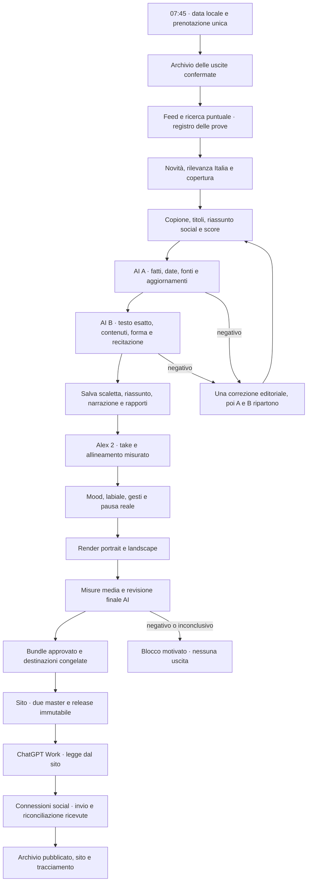

# CDaily: manuale per gli agenti e continuità di produzione

Revisione: **25 ottobre 2026**, fuso editoriale **Europe/Rome**. Questo è il punto di ingresso per riprendere il progetto senza la chat. Leggerlo integralmente prima di creare un’edizione. Le istruzioni correnti dell’utente prevalgono; registrare qui le nuove decisioni approvate, distinguendole dalle prove.

**Priorità corrente dello scheduler:** le prossime edizioni Italia sono in `productionMode=editorial`: raccolta, copione e A/B, poi esportazione e stato `editorial_ready`. Nessuna sintesi, render o pubblicazione automatica. [Stato non media e host separato](cdaily-nonmedia-readiness-20261024.md). Dopo questo lavoro l’utente ha autorizzato una **demo isolata di circa un minuto con voce e gesti**: nuovo take Alex 2, allineamento ASR misurato e due formati, senza cambiare la modalità schedulata o la presentazione pubblicata. [Demo, limiti e verifiche del 24 ottobre](cdaily-acting-demo-20261024.md). I timestamp nativi incoerenti non sono stati accettati né la produzione autonoma dichiarata pronta.

**Scheduler corrente:** host editoriale separato sul VPS, release `editorial-20261024230925890-08684ff9`, timer systemd attivo e persistente, segnale condiviso nel DB. Il precedente timer launchd del Mac è stato disattivato dopo verifica remota; le sezioni storiche che lo descrivono attivo restano cronologia. Il piano aggiornato il 25 ottobre prevede preparazione alle **07:45 Europe/Rome**, uscita obiettivo **08:15** e chiusura **08:45**. Orari applicati e riletti sul DB effettivo del server; gli snapshot già accodati restano invariati. Work gestirà la pubblicazione, non una sessione Codex; task e trasporti reali ancora da collaudare e media tuttora rinviati.

**Consegna sito approvata e attiva:** le puntate complete con `siteFirst=true` e revisione AI positiva vengono pubblicate dal servizio separato sul sito, nei due formati. Work legge `https://daily.conclavia.me/edizioni/it/latest.json` e la release immutabile, senza cartella del Mac. La demo del 24 è già online, esclusa dalle uscite Daily; `latest` è ancora `waiting`. [Architettura, URL, verifiche e limiti](cdaily-site-handoff-20261024.md). Redazione attuale `editorial-20261024230925890-08684ff9`, publisher `site-1792875880377-a7519222`; produzione video giornaliera e task Work restano da completare/collaudare. Questa decisione supera le indicazioni storiche di usare il CLI locale per la distribuzione delle nuove edizioni `siteFirst`.

## 1. Che cosa stiamo costruendo

Conclavia Daily / CDaily, made by Conclavia: informazione e intrattenimento con un presentatore sintetico riconoscibile, fatti verificabili e spiegazioni accessibili. Claim: **«Meno rumore, più contesto.»** Sito pubblico: <https://daily.conclavia.me>, italiano e inglese.

Il traguardo è una redazione AI: raccolta, selezione, scrittura, controlli editoriali separati, voce, recitazione, video e distribuzione. Nessuna persona approva la singola edizione autonoma. L’operatore configura il sistema, osserva gli esiti e può sospenderlo; non può trasformare un controllo AI negativo in un’approvazione. Il marchio e la linea sono scelte umane di progetto: non descrivere il sistema come immune da bias o senza responsabilità umane.

**Stato reale al 24 ottobre:** esistono i video approvati e il motore di recitazione; A/B sul testo e revisore finale sono implementati. Il nuovo percorso `cdaily-v1` Italia usa l’adattatore ElevenLabs del kit, pausa reale di 2 s, durata del take e render nativi a 50 fps. Chiave e ID Alex 2 sono ora salvati privatamente e l’identità è verificata via API. Le due richieste brevi hanno generato audio, ma il controllo respinge i tempi nativi incoerenti: il take di 8,88 s recuperato dalla cronologia va riusato per il collaudo, senza nuova sintesi cieca. **Sincronizzazione reale e master completo ancora da verificare**; nessuna ricevuta positiva forzata. Nessun nuovo Daily prodotto o pubblicato. Il worker legacy conserva Inworld/clock configurato per gli altri snapshot. Un timer caricato non certifica la filiera completa. La task Work deve ancora essere salvata e verificata nella UI. [Integrazione e collaudo](cdaily-alex2-integration-20261024.md).

## 2. Gerarchia dei riferimenti

1. [Standard di produzione approvato](cdaily-production-standard.md): aspetto, resa, voce e vincoli.
2. [Basi del Daily](cdaily-format-foundation.md): linea, saluto datato, chiusura e formati.
3. [Guida video](cdaily-video-guide.md), [linea editoriale](cdaily-editorial-line.md), [flusso editoriale](editorial-workflow.md).
4. [Pipeline del testo con controlli A/B](cdaily-text-production-pipeline-20261023.md).
5. [Regia di mood e gesti](cdaily-acting-direction.md), [integrazione semantica](cdaily-editorial-acting-20261023.md), [palmi approvati verso il petto](cdaily-palms-chest-20261023.md).
6. Dossier della singola edizione. I vecchi piloti sono riferimenti storici: non copiare i loro fatti, nomi provvisori, claim o configurazioni superate.

Presentazione grafica approvata: **`avatar-refined-presence-20261023`**, media **`12c91abdf743`**, 36,88 s, 50 fps, entrambi i formati. Base editoriale Italia apprezzata: **`2026-10-23-it-pilot-r3`**, media **`1876a600e330`**, 326,64 s. Questi nomi identificano riferimenti, non l’edizione da pubblicare oggi.

Prima di ogni produzione:

```sh
node scripts/tg/check-video-identity.mjs
```

I 17 fingerprint proteggono disegni, font e impostazione approvati. Non rigenerare immagini, cambiare logo, voce, volto o studio come effetto collaterale della creazione quotidiana.

## 3. Decisioni editoriali da conservare

- **Italia e World sono due prodotti distinti.** Italia ha un baricentro italiano. Estero solo con conseguenza concreta per questo pubblico o eccezione di rilievo mondiale motivata. World è in inglese, selezionato autonomamente, non la traduzione automatica di Italia. Il primo piano schedulato abilita soltanto Italia.
- Un conduttore iniziale. Indicativamente **5–7 notizie e 4–6 minuti**, con profondità diversa secondo importanza e prove. I 5 minuti sono una base, non una quota da riempire. Margini verso 6–7 minuti richiedono una motivazione concreta. Il worker legacy conserva il clock configurato; `cdaily-v1` mantiene 300 s come obiettivo editoriale e registra separatamente la durata misurata. La selezione del nuovo contratto ammette 5–7 notizie corroborate, senza riempire categorie; gli snapshot storici mantengono le proprie regole.
- Raccontare che cosa è successo, chi è coinvolto, perché conta, il contesto indispensabile e ciò che è incerto. Spiegare sigle e passaggi politici/economici a un non esperto. Evitare una lista di soli titoli.
- Aprire la giornata. Evitare «ieri sera», «seconda storia», frasi istituzionali, titoli allarmistici e gergo. Quando serve una numerazione dire «seconda notizia», preferendo un passaggio naturale sul tema.
- Nessun meteo locale ordinario, riempitivo leggero obbligatorio o curiosità priva di rilievo. Eventi gravi e conseguenze documentate possono meritare spazio.
- Nessuna opinione libera AI ricorrente: era una proposta, non una scelta approvata. Distinguere fatti, conseguenze motivate, attribuzioni e incertezze. Non promettere neutralità infallibile o una verità priva di interpretazione.

### Apertura e chiusura obbligatorie

La data è quella dell’edizione nel fuso configurato, non una stringa copiata o la data UTC della macchina. Esempio della prima prenotazione:

> Ciao, questo è Conclavia Daily. Oggi è il ventiquattro ottobre.

Seguono un orientamento accogliente e due o tre anticipazioni reali, poi **due secondi di pausa pulita misurata nell’audio**, prima della prima notizia. La pausa scritta nel prompt non è una pausa realizzata. Nessun colpo sonoro, click o taglio di consonanti al cambio: controllare anche la zona che nel vecchio Daily aveva un difetto intorno a 00:14.

Chiusura corrente:

> Segui Conclavia Daily. Fonti e approfondimenti su daily.conclavia.me.
> Scrivici nei commenti cosa vuoi approfondire: partiamo dalle tue domande.
> Meno rumore, più contesto.

L’indice indica **in basso sulla parola «commenti»**, secondo il suo tempo audio misurato; poi recupera. Invito e gesto sono approvati. Non promettere risposte a tutti. Mai «i link qui accanto al video»: indicare il sito.

## 4. Raccolta, novità e prove

Catalogo operativo in `src/lib/tg/sources.ts`: **14 feed, sette per edizione**, più ricerche puntuali su domini ammessi. Non affermare «50 fonti consultate» o «50 fonti istituzionali» se non esistono riscontri di quel numero. La provenienza reputata non sostituisce il controllo della singola notizia.

| Italia | World |
| --- | --- |
| ANSA, Rai News, Euronews Italia, Adnkronos | BBC, The Guardian, NPR, Al Jazeera |
| AGI, Il Sole 24 Ore, Istat | France 24, BCE, NASA |

Ricerche aggiuntive su fonti primarie pertinenti: istituzioni, enti statistici, bollettini ufficiali e documenti originali. Tendenze e Reddit possono suggerire temi, non dimostrare fatti. Non aggirare paywall, blocchi d’accesso o condizioni del sito. Titolo RSS senza corpo articolo = prova limitata al titolo; il feed BCE lo dichiara esplicitamente.

Per ciascuna candidata conservare URL, editore, origine indipendente, data di pubblicazione, data del fatto, estratto realmente recuperato, affermazioni sostenute, sviluppo nuovo e pertinenza per l’edizione. Non inventare URL o contenuti di pagine non lette. Due copie della stessa agenzia sono una sola origine.

La notizia richiede uno **sviluppo nuovo nelle ultime 24 ore**, con riscontri normalmente entro 36 ore. Sette giorni sono solo contesto. Data recente dell’articolo non rende recente l’evento. Confrontare con l’archivio delle pubblicazioni confermate, non soltanto con le bozze. Un tema già trattato richiede un fatto nuovo esplicito. Archivio irraggiungibile significa controllo impossibile, non archivio vuoto. Rileggere la freschezza prima dell’invio.

**Continuità approvata il 24 ottobre:** una notizia importante può tornare il
giorno successivo e nei seguenti con evoluzioni verificate. Aprire su ciò che
cambia e mantenere solo il contesto precedente necessario; non vietare il tema
perché già trattato e non replicare il vecchio resoconto. Un nuovo sviluppo del
pomeriggio precedente è ammissibile nel Daily mattutino, con la data corretta.
`new` e `update` si riferiscono all’archivio pubblicato di **questo Daily**:
senza uscite precedenti un fatto recente su una vicenda già in corso è `new`;
`update` richiede riferimenti reali a una nostra storia già uscita.
[Decisione e verifica](cdaily-news-continuity-20261024.md).

## 5. Pipeline e responsabilità



Questo è anche il target di raccordo: non tutti gli adattatori sono già operativi end-to-end.

1. **Ricercatore:** recupera prove reali e storia delle uscite; non scrive direttamente il master video.
2. **Editor:** sceglie la gerarchia, spiega ai non esperti, scrive esattamente ciò che verrà pronunciato; include titoli, schede e riassunto social.
3. **AI A:** verifica affermazioni, numeri, date, attribuzioni, freschezza e differenze dal pubblicato con prove consultate. Controlla anche le affermazioni nelle schede e nel riassunto.
4. **AI B:** chiamata distinta, senza ereditare il verdetto A come risposta da confermare. Rilegge tutto il testo da sintetizzare, forma, contenuti, omissioni, apertura datata, chiusura e congruenza dei mood. Un revisore separato non prova da solo indipendenza assoluta o assenza di bias.
5. **Produzione:** solo dopo A e B positivi e vincolati allo stesso hash. Qualunque modifica a testo, data, prodotto, fonti o score invalida i controlli. Non pronunciare i marcatori di regia.
6. **Revisore finale:** controlli locali sui file decodificati, audio e VTT; AI sui fotogrammi campionati nei due formati e sul pacchetto da pubblicare. Non dichiarare che il campionamento dimostra naturalezza di ogni movimento, pronuncia perfetta o visione integrale.
7. **Work/publisher:** consuma il pacchetto congelato; non riscrive caption, titoli o fatti e non carica file «simili» trovati nei Download. Pubblicazione solo con hash, attualità, destinatari, finestra e stato validi.

Una sola correzione editoriale e una sola riscrittura per durata, contatori persistenti prima delle chiamate. Un secondo esito negativo ferma l’edizione. Massimo tre tentativi tecnici con backoff e lease; non usare riavvii per ripristinare contatori o consumare sintesi all’infinito. Un errore editoriale non è un guasto transitorio da riprovare ogni minuto.

## 6. Testo, mood e gesture

Il writer usa uno score semantico per clausola, non una regola «terremoto = mani in preghiera». Può cambiare emozione nello stesso periodo. Esempio di sintassi supportata:

```xml
<mood:attention intensity="0.45" intent="explain">Il provvedimento cambia questa regola.</mood>
<mood:doubt intensity="0.35" intent="reflect">Gli effetti pratici restano da verificare.</mood>
<mood:empathy intensity="0.5" intent="reassure">Per le persone coinvolte il momento resta difficile.</mood>
```

Mood canonici: `attention`, `curiosity`, `doubt`, `agreement`, `amusement`, `empathy`, `disagreement`, `surprise`. `fun` è un alias d’autore per `amusement`. Intensità 0–1, misurata. Tag sconosciuti, annidati, aperti o testo fuori dai tag sono rifiutati. Usare solo gli intent supportati dalla feature `/performance`, mai ID inventati di pose. Puntatori e chiusura sono controllati dall’applicazione.

La sintesi riceve **solo il testo pulito**, con frasi collegate. Tempi di parole/fonemi derivano dal take reale. Quando l’allineamento è stimato, etichettarlo; non dichiararlo misurato. Non inventare durate uniformi per la comodità del labiale. Il consenso permanente all’allineamento riguarda soltanto audio sintetico Alex e copione pubblico, non file personali.

Regia approvata: `dailyPerformanceForPosture('standing')`, articolata, vitalità `.9`, phrasing `connected`, varietà `semantic`. Il motore riutilizzabile vive nel kit. Corpo e volto accompagnano insieme il significato: preparazione, accento, tenuta e recupero con spalle, busto, collo, sguardo, polsi e dita. Anche la quiete è utile. Evitare loop casuali, pendoli lenti e gesti identici a ogni frase.

- **Palmi uniti:** approvati vicini, punte delle dita a contatto visivo e inclinazione verso il petto. Occasionali, coerenti con rassicurazione/empatia; non obbligatori sulle tragedie.
- **Tocco al mento:** approvato, occasionale per riflessione/dubbio, senza attraversare il volto.
- **Indice in alto:** accento raro su una parola realmente importante, poi recupero.
- **Indice in basso:** chiusura sui commenti, ancorato alla parola misurata.
- **Mani raccolte e offerte:** variazioni anatomiche, polsi presenti, dita piene anche di taglio e leggermente indipendenti.
- **Dita intrecciate:** solo in una scena da seduto; non trasferire la posa al presentatore in piedi.

Una nuova posa va provata prima in **6–10 secondi muti** e verificata in transizioni/contatti; non rigenerare un video intero per ogni prova delle dita. Valutare compenetrazioni, polso invertito, silhouette, mano di taglio, uniformità di velocità, cuciture di braccia e coordinazione con il busto. Non cambiare lo stile grafico per risolvere un difetto cinematico.

## 7. Identità e media

Adulto umano-robot chiaro, volto modellato e leggibile, tempie sintetiche, collo articolato, busto snello, giacca petrolio e mani anatomiche. Studio luminoso con pietra, legno e verde; niente ritorno al volto scuro, all’aspetto infantile o al set bordeaux. Riutilizzare `dailyVideoIdentity`, `dailyApprovedAvatar` e gli asset canonici. Font e wordmark approvati, senza ricomposizioni arbitrarie.

Voce: **Alex 2 - daily**, giovane, amica, colloquiale, naturale, agile e con frasi collegate. Il take approvato proviene dall’account ElevenLabs; conservare impostazioni e provenienza osservata. Non dedurre la versione del modello dal solo filename. Nessuna sostituzione automatica con un’altra voce. Crediti, disponibilità API e diritti del take vanno registrati come fatti verificati, non presunti dal nome del piano.

Nessuna musica nel corpo delle notizie. Base corrente: niente musica; eventuale sigla solo nei primi quattro secondi, con asset originale/autorizzato. Il vecchio sottofondo non è approvato.

Due composizioni native: **1920×1080** e **1080×1920**, standard approvato **50 fps**, H.264/AAC con audio presente e `faststart`. Non ritagliare automaticamente l’orizzontale. Poco testo, titolo breve e contesto leggibili da telefono; VTT separato attivabile, senza enorme blocco grigio o etichetta permanente sul petto. Trasparenza AI in pagina e metadati. Il sito usa un player adattivo/selettore, non due maxi-video affiancati.

## 8. Pacchetto obbligatorio di ogni Daily

Ogni edizione ha un’identità unica `(edition, date)` e un dossier datato. Il runner salva `edition-dossier.md` nella sua directory privata persistente; per le prove curate si aggiunge anche `docs/tg/daily-YYYYMMDD-it.md`. Il contenuto pubblico non va conservato soltanto nella chat o nelle caption social.

| File | Contenuto |
| --- | --- |
| `landscape.mp4`, `portrait.mp4` | I due master approvati della stessa puntata |
| `audio.mp3`, `captions.vtt`, `manifest.json` | Audio, sottotitoli e timeline |
| `narration.txt` | Parole esatte inviate alla voce, senza tag |
| `performance-score.txt` | Mood/intensità/intenti, stesso testo del master |
| `social-summary.txt` | `TgScript.description`: 80–130 parole, massimo 1100 caratteri |
| `rundown.md` | Titoli ordinati come le notizie in onda, descrizioni e fonti pertinenti |
| `social-posts.json` | Caption per canale, da `publicationCopy`, senza nuova scrittura AI |
| `edition-dossier.md`, `research.json`, `script.json` | Dossier datato, prove e copione integrali nel volume persistente |
| `editorial-package.json` | Hash del copione, scaletta e rapporti A/B; non è un’autorizzazione di pubblicazione |
| Dossier + prove | Cutoff, selezione/esclusioni, novità dal pubblicato, fonti, limiti, impostazioni e verifiche |

I primi cinque file sono gli asset del bundle video gestito dal backend; gli altri sono documenti privati accanto agli asset, non nuovi URL pubblici con accesso indiscriminato. `editorial-package.json` resta marcato `unpublished`: solo ricevute confermate possono attestare la pubblicazione.

Riassunto e scaletta coprono **tutte e sole le notizie pronunciate**, nello stesso ordine, senza introdurre fatti nuovi o togliere qualificazioni. La descrizione di ogni titolo riusa la scheda del copione o una sua frase esatta. Il publisher non «migliora» il testo dopo l’audit. La GUI mostra questi materiali nella redazione anche quando il video è ancora bloccato.

## 9. Tool, calendario e riavvio

Il timer Mac descritto qui è cronologia e rimane disattivato: redazione e publisher sito correnti sono i due servizi separati sul server. Non ricaricare launchd mentre sono attivi.

CLI nel repository Meeting:

```sh
npm run daily:agent -- plan
npm run daily:agent -- status
npm run daily:agent -- configure --dry-run
npm run daily:agent -- configure
npm run daily:agent -- install --dry-run
npm run daily:agent -- install
npm run daily:agent -- persist
npm run daily:agent -- tick --dry-run
npm run daily:agent -- run --date=2026-10-24 --dry-run
npm run daily:agent -- package --date=today
npm run daily:agent -- publish --date=today --dry-run
```

`plan` è un’anteprima del file `config/tg/daily-agent.json`; `configure` applica quel piano alle impostazioni Italia nel DB. Dopo il salvataggio, **il DB/GUI è la configurazione effettiva** e viene letto a ogni tick. Le edizioni già accodate conservano la propria configurazione congelata. Ripetere `configure` sovrascrive le impostazioni di Italia: usarlo soltanto per un cambio deliberato di piano.

Piano storico del 24 ottobre, superato dal calendario sotto: primo giorno **2026-10-24**, creazione **08:00 Europe/Rome**, uscita proposta **09:00**, chiusura **09:30**. In ottobre il cambio dell’ora è gestito dal fuso IANA: il 24 l’avvio è 06:00 UTC, il 25 è 07:00 UTC. `run` non permette di retrodatare una puntata o recuperare automaticamente un’uscita di ieri. Una partenza tardiva oltre la finestra produce uno skip, non un video di notizie vecchie.

La task locale launchd controlla il calendario ogni minuto; fuori finestra non esegue ricerca AI. All’interno accoda una sola edizione e invoca il worker con `--once --job=ID --no-schedule --no-publish --approved-daily`. L’indice unico Mongo e le lease impediscono produzioni concorrenti e duplicati. Le fasi terminali non vengono rigenerate dal timer. `blocked` richiede una risoluzione esplicita; non azzerare automaticamente i contatori.

Stato/log/receipt locali sono in `.daily-agent/` (privati, ignorati da Git). `status` verifica anche il caricamento effettivo del servizio e distingue DB raggiungibile, timer caricato, voce e task Work. Il plist caricato dal repository sopravvive alla chiusura del terminale, **viene ripristinato ai login soltanto dopo `persist`**. L’opzione `persist` registra un collegamento al plist in `~/Library/LaunchAgents`, senza sostituire servizi estranei. Per ripristinarlo nella sessione utente se scaricato: `install`, poi `status`. Disattivazione: `uninstall`; sospensione quotidiana: checkbox preparazione automatica nella GUI.

Il Mac deve essere acceso e il database raggiungibile. Al risveglio si rivaluta la finestra: nessun recupero cieco. Non promettere puntualità da un computer spento. Non avviare un secondo timer server sullo stesso prodotto mentre questo è attivo. Il worker generico non invia edizioni con `publicationDriver: chatgpt-work`.

## 10. ChatGPT Work e distribuzione

[Prompt e istruzioni correnti per la task Work](cdaily-work-publication-task.md). Per le nuove edizioni `siteFirst` è una task **web/in cloud**, alle **08:15 Europe/Rome**, che legge il sito pubblico e le connessioni autorizzate. Non richiede la cartella del Mac, Mongo o SSH. Il salvataggio e il primo esito vanno verificati nella UI; il CLI non inventa un ID task.

Work legge `it/latest.json`, richiede data odierna e `kind=daily`, poi recupera la release immutabile con i due formati e i testi approvati. Usa le connessioni social del progetto, confronta account e post esistenti e riconcilia le ricevute prima di un nuovo invio. Una demo, un vecchio Daily o un esito incerto non autorizzano un caricamento. Le ricevute Work restano nella task e nei servizi: non attribuirle all’outbox nativa senza un adattatore verificato. Quest’ultima esclude le edizioni `siteFirst`; il precedente comando locale `publish --date=today` rimane soltanto per gli altri snapshot.

Canali pubblici del progetto:

- Instagram: <https://www.instagram.com/conclavia.me/>
- TikTok: <https://www.tiktok.com/@conclavia.me>
- YouTube: <https://www.youtube.com/@conclavia>
- Facebook: <https://www.facebook.com/profile.php?id=61595242723119>
- LinkedIn: <https://www.linkedin.com/company/conclavia-me/>
- X: <https://x.com/conclavia_me>
- Spotify: <https://open.spotify.com/show/5tQgR2tSQ3GQbpvyc3Xsze>

Il backend attuale supporta gli adattatori YouTube, Instagram, TikTok/Metricool e un host video compatibile Spotify; un link pubblico non dimostra un account autorizzato. Facebook, LinkedIn e X sono riferimenti pubblici, non publisher già implementati. L’host Spotify e gli altri collegamenti richiedono prove reali. Nessun acquisto di piani o campagna advertising automatico è incluso in questo job; budget storico di progetto 500 €/mese.

## 11. Deploy target e condizioni per la produzione

Percorso di deploy operativo: repository `../conclavia-deploy`, istruzioni `docs/codex-deploy.md`. Riutilizzare il suo tooling, i rilasci immutabili e le verifiche; non inventare comandi SSH che riscrivono servizi o variabili esistenti. Kit prima dei consumer. Build e render fuori dal VPS pubblico piccolo; DB, archivio e web possono rimanere separati dal render host. Mai esporre redazione, segreti, file privati o route di gestione al pubblico.

Il rilascio Daily ha questi passaggi:

1. Validare identità e test senza chiamate a pagamento, poi build del consumer.
2. Creare il rilascio con il tool deploy esistente; congelare commit/checksum del kit, consumer, configurazione e asset. Render host e app devono usare la stessa revisione, non due checkout divergenti.
3. Deploy in modalità preparazione, invii ancora disabilitati. Volumi persistenti per DB, artifact, cache dei take e ricevute; controllo della capacità disco.
4. Verificare voce Alex 2 API, pausa e allineamento reali, durata elastica, entrambi gli export a 50 fps e revisore finale sul master completo di prova.
5. Verificare le destinazioni senza pubblicare; eseguire una prova di consegna autorizzata e verificare le ricevute. Verificare separatamente la task Work salvata e il primo run.
6. Fermare il timer precedente prima di abilitare il nuovo. Solo allora attivare gli invii; un unico scheduler di creazione e un’unica autorità di pubblicazione.
7. Osservare durata, costo, freshness, esiti A/B e media, heartbeat e ricevute. In caso di problema sospendere gli invii e conservare prove/artefatti. Rollback del codice non ripubblica i job già consegnati.

Per un’autonomia affidabile il target è un render host sempre acceso, non il laptop. La task Work desktop locale richiede macchina/app disponibili; un futuro accesso Work web richiede un bridge autenticato al backend, non semplicemente un URL pubblico al DB. Questo bridge non è dichiarato implementato.

## 12. Checklist per l’agente successivo

- Leggere i riferimenti sopra e `AGENTS.md`; verificare la data locale e `status`.
- Identità approvata intatta; nessun take riciclato presentato come nuovo; prima salutare e dire la data.
- Italia pertinente, fatti nuovi, archivio accessibile, prove indipendenti e contesto per tutti.
- Copione completo, titoli, riassunto e score coerenti; AI A e AI B positivi sullo stesso hash.
- Alex 2 reale, voce naturale e intelligibile, nessuna musica nelle notizie; pausa vera pulita.
- Recitazione semantica variata, contatti corretti, nessun intreccio da in piedi, dito giù sui commenti.
- Due composizioni native, VTT, audio presente, controlli media e revisione finale validi.
- Dossier e testi social salvati; invio solo del bundle congelato, senza correzioni dell’ultimo minuto non verificate.
- Conservare esiti negativi e ricevute. Comunicare chiaramente «preparato», «bloccato», «approvato», «inviato» e «pubblicato»; mai confonderli.

Documentazione ufficiale verificata per lo scheduling: [ChatGPT Work Automations](https://learn.chatgpt.com/docs/automations), [task persistenti e memoria](https://learn.chatgpt.com/docs/dots/tasks-and-memory), [timer launchd Apple](https://developer.apple.com/library/archive/documentation/MacOSX/Conceptual/BPSystemStartup/Chapters/ScheduledJobs.html).

## 13. Mappa del codice e prossime priorità

| Responsabilità | Sorgente proprietaria |
| --- | --- |
| Tool operativo / calendario | `scripts/tg/daily-agent.ts`, `src/lib/tg/agent-schedule.ts`, `schedule.ts`, `config/tg/daily-agent.json` |
| Coda unica, lease e stato persistente | `src/lib/tg/store.ts`, `src/models/tg/TgRun.ts` |
| Ricerca, scrittura, A/B | `src/lib/tg/agents.ts`, `sources.ts`, `freshness.ts`, `script-review.ts`, `pipeline.ts` |
| Riassunto, scaletta e dossier | `edition-texts.ts`, `rundown.ts`, `edition-text-files.ts` in `src/lib/tg` |
| Runner / voce / media | `scripts/tg/worker.ts`, `src/lib/tg/media.ts`, `speech-plan.ts`, `opening-pause.ts` |
| Regia specifica CDaily | `src/lib/tg/performance-direction.ts`, preset/identità in `src/components/tg` |
| Anatomia, movimenti, markup, audio condivisi | `../conclavia-avatar-kit/src/features/avatar`, `performance`, `speech`; usare gli entry pubblici |
| Revisione finale / approvazione | `src/lib/tg/final-review.ts`, `final-review-policy.ts`, `review.ts` |
| Pubblicazione e ricevute | `src/lib/tg/publishing.ts`, `publishers.ts`, modelli outbox e controllo di distribuzione |
| GUI privata | `/podcast/tg/redazione`, `TgNewsroom.tsx`, `TgSchedulePanel.tsx` |

**Ordine per completare l’autonomia video:** chiave e identità Alex 2 sono verificate; riusare il take breve recuperato, risolvere i tempi incoerenti e ascoltarlo, poi provare il job completo con revisore finale sui due master. Non rifare onboarding o sintesi per ripartire da questa chat. Verificare canali e task Work; abilitare invii solo con quelle prove. Il percorso voce/clock/50 fps è implementato e testato offline, non ancora collaudato integralmente sul provider reale. Nel modificare la voce gestire i segreti secondo `AGENTS.md`, senza copiarli in chat o nel repository. Le capacità riutilizzabili appartengono al kit, le scelte editoriali a Meeting. Modifiche al kit richiedono verifiche di feature, test pertinenti e build di entrambi i consumer.

Il 24 ottobre sono stati applicati gli orari al DB Italia e caricato il timer locale, persistente al login. Il tunnel Mongo esistente è stato ripristinato e il DB verificato raggiungibile. La GUI aggiornata risponde sulla porta **3107**. Nessuna ricerca, sintesi o pubblicazione reale è stata eseguita anticipatamente. La preparazione delle 08:00 è attiva; il video completo resta condizionato alle integrazioni sopra. [Rapporto di verifica](cdaily-agent-verification-20261024.json).

## 14. Primo avvio reale — 24 ottobre 2026

Il timer ha eseguito la raccolta alle **08:00 Europe/Rome**. La prima verifica
ha bloccato la puntata: l’AI aveva classificato cinque sviluppi come `update`
con archivio pubblicato vuoto, oltre a due rilievi distinti sui riscontri.
La [regola di continuità](cdaily-news-continuity-20261024.md), i prompt e lo
schema sono stati corretti in `bc0c5e8`. Questo non ha approvato il vecchio rapporto.

Su richiesta dell’utente di procedere è stato applicato **un solo nuovo tentativo
esplicito**, attraverso l’azione dell’app con controllo di versione. Il rapporto
precedente è conservato in `.daily-agent/editorial-recovery-20261024/`.
La nuova raccolta ha superato attualità e controlli A/B dopo l’unica correzione
editoriale automatica di un titolo troncato. Alle **08:31** il worker si è
fermato prima della voce per Alex 2 non collegato, salvando tutti i testi.

[Dossier dell’edizione](daily-20261024-it.md). Il testo verificato conta **328
parole**: resta una bozza breve, da approfondire con contesto sostenuto dalle
fonti per la base di circa 4–6 minuti. Il passaggio A/B non certifica il clock
né la qualità del master. Un ampliamento richiede nuovi controlli; non
azzerare i tentativi o approvare il pacchetto per aggirare il blocco.

Nessun audio/video nuovo o invio social. I rapporti testuali hanno la normale
scadenza e non autorizzano una produzione tardiva senza verifica aggiornata.
[Piano concreto per Alex 2](cdaily-alex2-api-plan-20261024.md). Il browser non è
accessibile e il catalogo plugin non ha restituito un connettore ElevenLabs.
L’utente ha poi chiarito che AWS non è usato e ha autorizzato esplicitamente:
«Sì, rimuovi il blocco AWS e usa la configurazione privata». Il blocco generico
in `AGENTS.md` è stato rimosso e sostituito con regole per il backend esistente.
Il raccordo ElevenLabs usa quella configurazione, senza nuovi servizi AWS o
una richiesta di deroga. Non presumere che una chiave sia presente o valida
senza una verifica che mostri soltanto stato e presenza, mai il valore.


## 15. Percorso Alex 2 e controlli prima del video — 24 ottobre

[Dettagli e comandi](cdaily-alex2-integration-20261024.md). `npm run daily:voice -- status` non consuma crediti né legge il DB; mostra soltanto presenza/configurazione e prove locali. `check` verifica l’identità dell’ID con una lettura API. `probe --confirm` esegue una sola sintesi breve pubblica, con audio e ricevuta privati. La GUI e il runner distinguono configurazione da sintesi realmente verificata. Non inventare una ricevuta né impostare un flag per fingere l’avvenuta prova.

Prima di A/B il nuovo contratto blocca un testo inferiore a 480 parole, oltre 1200, o con principale sotto 90/secondarie sotto 45. È un controllo economico contro la compressione, non una misura di verità o qualità: non aggiungere riempitivi per soddisfarlo. Usa la stessa unica correzione editoriale persistente; poi A e B ripartono sul testo riscritto. La bozza di 328 parole del primo avvio resta bloccata; non azzerarne i contatori.

Una sola registrazione per paragrafo di notizia, con contesto dei paragrafi vicini e più mood semantici. Cache legata a voce, modello, impostazioni, testo e contesto; tentativo persistente scritto **prima** della chiamata. Se l’esito è incerto o la cache non è integra, fermare e controllare: nessuna ripetizione automatica a pagamento. Le parole native scandiscono cue, quiete, labiale e indice in basso. Il labiale rimane una stima fonetica ancorata alle parole, non fonemi misurati dal provider.

Il master conserva l’obiettivo in `product.seconds` e la durata reale in `manifest.seconds`; rendering, revisione e approvazione usano quest’ultima. Il limite tecnico 180–420 s rileva take anomali; l’obiettivo resta circa 4–6 minuti, con chiarezza e sostanza. Nessun `atempo` nel percorso Alex 2. Le prove video devono ancora confermare recitazione, voce e leggibilità reali. Nessuna modifica al sito pubblico o ai master già approvati in questa integrazione.

Aggiornamento del collegamento: onboarding ufficiale ElevenLabs completato con conferma esplicita dell’utente; `.env.local` contiene chiave e ID esatto, permessi `0600`, altre impostazioni conservate. `check` è positivo. Due richieste di prova generano il testo pubblico, ma il validatore respinge 139 intervalli su 143 con fine precedente all’inizio. La cronologia v4 li registra come dialogo a una voce: cercare la corrispondenza esatta negli input, non presumere assenza dopo un filtro sul solo `voice_id`. Take più recente recuperato senza rigenerazione in `.daily-agent/alex2-voice-proof/recovered-take.wav` (8,88 s); sincronizzazione e ascolto ancora pendenti, `synthesisVerified=false`. Nessun cambio piano, acquisto, nuovo Daily o pubblicazione. Non distribuire questo stato locale come prova di configurazione sul server di produzione.

## 16. Calendario mattutino — 25 ottobre 2026

Su richiesta dell’utente: preparazione **07:45**, pubblicazione obiettivo **08:15**, chiusura **08:45**, sempre `Europe/Rome`. Il 25 ottobre corrispondono a 06:45, 07:15 e 07:45 UTC; il giorno prima sarebbero state 05:45, 06:15 e 06:45 UTC. Il timer server controlla ogni minuto il prodotto salvato nel DB: aggiornare il solo JSON non basta.

Il comando deploy `daily-editorial schedule`, dopo il rilascio del bundle aggiornato, applica solo i due orari al prodotto Italia esistente, con controllo di versione. Conserva modalità editoriale, destinazioni, configurazione privata e job congelati. Non accoda lavori né chiama provider. La task Work va ancora salvata nella chat esistente alle **08:15**, usando il prompt aggiornato; nessun ID inventato.

Trenta minuti costituiscono un budget da collaudare, non un tempo di produzione già dimostrato: raccolta e A/B, take Alex 2/allineamento, due render a 50 fps e revisione finale devono restare completi. Il primo collaudo cronometrato dirà se serva anticipare il lavoro. Se il pacchetto non è pronto, Work segnala l’attesa e non pubblica demo o notizie vecchie. La generazione automatica di media resta da completare.

Verifica operativa: rilascio `editorial-20261024230925890-08684ff9`, DB collegato, timer server attivo e abilitato. `daily-editorial schedule` ha confermato `changed=true`, avvio 07:45, uscita 08:15 e chiusura 08:45 per il 25 ottobre; stato `before_production`, nessuna ricerca o pubblicazione avviata dal comando. Verificati nove test calendario/pack, typecheck, lint, 65 test Node e 54 Python del deploy più il test Caddy nativo. Work non risulta ancora salvato; nessuna autonomia media completa dichiarata.
