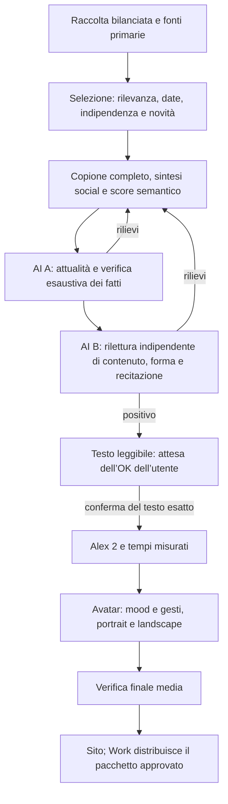

# CDaily — testo prima del video

Decisione dell’utente del **25 ottobre 2026**. Questo aggiornamento prevale sui vecchi clock da quattro/cinque minuti e sul precedente avvio automatico dei media. Lo stile visivo approvato rimane quello dello [standard di produzione](cdaily-production-standard.md).

## Promessa editoriale

**Meno rumore, più contesto.** Notizie spiegate a un pubblico curioso e non specialista, con ritmo agile e linguaggio amichevole. L’edizione Italia ha un baricentro italiano: decisioni pubbliche, economia, lavoro, salute, società, servizi, conoscenza e risultati di rilievo. Nessuna categoria deve essere riempita per forza.

L’estero entra per conseguenze italiane documentate oppure come eccezione per un evento mondiale davvero importante, motivata nel dossier. Non inventare un collegamento con l’Italia per ammetterlo. World rimane un prodotto distinto in inglese.

**Meno di dieci minuti**, inclusi apertura, pausa e saluti. Indicativamente cinque–otto minuti quando il materiale lo giustifica; nessun obbligo di arrivarci. Di norma sei–otto notizie, con margine cinque–nove nel profilo corrente: selezione e spazio dipendono da rilevanza, novità e prove. Se mancano notizie solide, ampliare la ricerca entro il budget e poi fermare o rivedere l’edizione; mai aggiungere riempitivi. Il conteggio non certifica la qualità. Il take reale determina il minutaggio; niente rallentamenti, lettura precipitosa o silenzi per riempirlo. Budget prudenziale massimo: 1.350 parole, con controllo finale sull’audio.

## Struttura del parlato

1. Saluto a tutti, nome, claim e giorno/mese effettivi, in pochi secondi. Esempio del 25 ottobre: **«Ciao a tutti, è Conclavia Daily. Meno rumore, più contesto. Oggi è il venticinque ottobre.»** La data è generata dai metadati nel fuso Europe/Rome; mai copiata da un vecchio video.
2. **Due secondi reali di pausa pulita** prima della prima notizia. È regia, non una frase da leggere. Nessun impatto sonoro o musica sotto le notizie.
3. Notizie con pesi diversi: sviluppo nuovo, protagonisti e loro ruolo, contesto minimo, conseguenza documentata o limite effettivo. Spiegare le sigle necessarie alla prima occorrenza. Non presumere che il pubblico conosca il fatto precedente.
4. Transizioni brevi e variate. Niente «seconda storia», «ieri sera» come presentazione del programma, ripetizione del sommario o lezioni sulle procedure di verifica. Una data precedente resta corretta quando è la data vera dell’evento.
5. Fonti/approfondimenti sul sito, invito ai commenti e alle richieste, follow, saluto finale: **«Fonti e approfondimenti su daily.conclavia.me. Scrivici nei commenti cosa vuoi approfondire: partiamo dalle tue domande. Segui Conclavia Daily. Ciao a tutti, a domani!»** Un solo gesto verso il basso, ancorato alla parola misurata «commenti».

Nessuna opinione libera AI ricorrente è stata approvata. Distinguere fatti, dichiarazioni attribuite e interpretazioni. Non promettere neutralità infallibile perché la produzione usa AI. Un titolo corretto non salva un testo poco chiaro, ripetitivo o sbilanciato.

## Raccolta e verifica delle fonti

Catalogo corrente: **25 feed complessivi, 18 per Italia**, con **11 gruppi editoriali/origini** nel registro italiano. Comprende Rai, ANSA, AGI, Adnkronos, Euronews, Il Sole 24 Ore, la Repubblica, TGcom24, Open, Governo e Istat. Gli otto feed ANSA (sette aggiunti) sono una sola origine, così come due URL della stessa testata o due copie della stessa agenzia. Il catalogo non è il numero di fonti consultate da ciascuna edizione.

Il collaudo del 25 ottobre ha raccolto 411 voci RSS, poi bilanciate per editore e sezione: **411 candidate non significano 411 notizie verificate**. Non aggiungere feed rotti o vecchi solo per far crescere il numero: Corriere fermo al 2024, Sky 410 e Il Post 403 sono stati esclusi dalla raccolta provata. Conservare diagnostica e data di verifica privatamente.

Per ciascun fatto centrale servono riscontri attuali di almeno due origini distinte sullo **stesso evento**, ricerca web separata e fonte primaria quando disponibile. Un comunicato prova che qualcuno ha dichiarato qualcosa; da solo non prova tutte le sue conclusioni. La documentazione istituzionale aiuta su norme, numeri e stato dei provvedimenti; non sostituisce il confronto editoriale. Reddit e tendenze indicano piste, non costituiscono prove.

Lo sviluppo deve essere nuovo nella finestra delle ultime 24 ore e rispetto all’archivio realmente pubblicato. Riscontri entro 36 ore; materiale precedente solo come contesto dichiarato. Distinguere evento, annuncio, aggiornamento della pagina e prima pubblicazione di uno studio. Un tema importante può tornare con una vera evoluzione: spiegare prima che cosa cambia, poi il minimo contesto datato. Un’analisi ripubblicata o un titolo riformulato non sono novità. Anche due slot della stessa puntata che raccontano lo stesso evento vanno accorpati.

Ogni candidata conserva: URL, editore/origine, data, estratto effettivamente acquisito, sviluppo verificato, rilevanza per il pubblico, incertezze, confronto con il pubblicato ed esito di ammissione/esclusione. Nessuna data o precisione temporale inventata per superare il controllo.

## Pipeline e conferma manuale



**Ora il controllo manuale è obbligatorio.** Configurazione persistita: `productionMode: editorial`, `textReviewMode: manual`; avvio Mac alle 07:30 invariato. Anche passando per errore a `full`, la pipeline e la sintesi rifiutano media privi della ricevuta dell’OK sul testo. Non creare questa ricevuta da un verdetto AI.

Il modello editoriale è esplicito nel piano: `editorialModel: gpt-5.4`, applicato soltanto al processo Daily. La configurazione delle altre funzioni Meeting rimane distinta. Il modello effettivo entra nelle chiavi delle cache del laboratorio; non riusare un esito prodotto con un’altra configurazione come se fosse una nuova verifica.

A controlla tutti i segmenti, titoli, cartelli e sintesi; B legge il medesimo parlato completo con score e prove, senza ricevere il verdetto di A. Conservare rapporti positivi e negativi, errori tecnici e versioni precedenti. Un errore di API non è un giudizio positivo. Le citazioni scientifiche NEJM vengono controllate nei metadati pubblici Crossref: un DOI esistente ma riferito a un’altra pubblicazione, oppure senza identità verificabile rispetto al titolo acquisito, viene escluso dai riscontri utilizzabili. Questo controllo riguarda l’identità bibliografica, non certifica il metodo scientifico o tutti gli altri siti. Conservare la versione precedente delle prove e rifare A/B dopo una correzione. Le cache legano anche prove, ricerca, data e profilo, non soltanto le parole. Correggere i rilievi, non ripetere il controllo alla ricerca di un sì.

Il nuovo rapporto A registra ciascun rilievo sul target preciso come `unsupported` o `unverifiable`, con motivazione e prove; qualunque target negativo blocca il passaggio. Una nota positiva non va inserita fra i problemi bloccanti. I vecchi rapporti con rilievi liberi restano conservati e mantengono il loro esito. Quando parte una nuova revisione, la precedente consegna da approvare viene archiviata privatamente e sostituita da «revisione in corso»: nessun vecchio dossier positivo deve sembrare quello corrente.

Il laboratorio manuale consente al massimo dodici riscritture automatiche persistenti per sessione; il job storico del primo ciclo mantiene i propri contatori. La cifra è un limite operativo, non un obiettivo. Una nuova revisione esplicita del redattore può essere sottoposta ad A/B senza azzerare quei contatori; non abilita altre riscritture automatiche oltre il limite. Se il problema riguarda la selezione, cambiare realmente le prove/scaletta invece di riscrivere all’infinito lo stesso materiale. Le richieste con esito incerto non vengono automaticamente ripetute.

La ricevuta `textApproval` lega conferma esplicita, revisore, data, hash del copione completo e hash dello score. Cambiare parole, titoli/sintesi, mood o intenzioni invalida la conferma; il testo aggiornato va ricontrollato e ripresentato. I controlli di attualità vanno rinnovati quando scadono: un’approvazione manuale non rende fresche notizie vecchie. Non trasformare automaticamente un testo di oggi in una puntata di domani.

Solo dopo l’OK si prepara il take Alex 2, si misura la durata reale e si genera il video nei due formati nativi. Restano i controlli finali su testo/audio, giunzioni, mani, volto, leggibilità e pubblicazione. Il sito ospita solo presentazione approvata e vere edizioni rilasciate. Work legge il pacchetto odierno dal sito; l’orario delle 08:15 è un obiettivo subordinato ai controlli e all’OK, non un permesso di saltarli.

## Mood e gesti

Ogni clausola conserva `text`, `mood`, `intensity`, `intent`, `storyId`, `speaker` e `sourceIds`. Lo score testuale è derivato da questa rappresentazione unica e resta separato dalle parole da pronunciare. Una frase può attraversare più atteggiamenti quando cambia significato; una notizia non riceve un solo mood fisso.

Mood: attenzione, curiosità, dubbio reale, empatia, accordo relazionale, sorpresa motivata; disaccordo e divertimento solo se appropriati al contenuto. Mai sorriso su sofferenza, enfasi di parte o rassicurazioni senza prove. Non usare tutto il catalogo per esibire varietà.

Le intenzioni sono spiegare, chiedere, confrontare, sottolineare, rassicurare con misura, invitare, riflettere e riconoscere. Il planner condiviso sceglie un gesto compatibile oppure quiete, con memoria delle famiglie recenti. Coordina mani/dita, polsi, braccia, spalle, busto, collo e sguardo; preparazione, accento e rilascio sono continui. Palmi uniti verso il petto e tocco al mento sono accenti occasionali, non reazioni preassegnate a terremoti o categorie. Intreccio solo da seduto. Il puntamento sui commenti è l’unico gesto obbligatorio.

Prima dell’audio non inventare timestamp, fonemi, velocità del labiale o durate dei gesti. Il take vero governa tutti i tempi. Conservare grafica, font, studio, voce e rig approvati; questa revisione è editoriale e non rigenera il personaggio.

## Consegna da leggere prima del video

- Copione intero: apertura, tutte le notizie e chiusura, senza marcatori pronunciabili.
- Titoli e scaletta in ordine; stima di lettura dichiarata come stima.
- Fonti per notizia, contesto, sviluppo nuovo, eccezioni mondiali ed esclusioni motivate.
- Tabella mood/intenzioni e score verificato; nessun audio necessario per approvarne il significato.
- Sintesi social autonoma nella lingua dell’edizione, che copra tutte le notizie senza nuove affermazioni. Il publisher riusa quella controllata.
- Rapporti A/B reali, hash della versione e stato **in attesa dell’OK dell’utente**.

Laboratorio privato riprendibile:

```sh
npm run daily:editorial
```

Produce materiali in `.tg-artifacts/editorial/AAAA-MM-GG/` e il dossier leggibile in `docs/tg/editions/AAAA-MM-GG-it-editorial-review.md` solo dopo A/B positivi. Non dispone di porte per voce, rendering o pubblicazione. Una revisione motivata della selezione si passa come JSON privato nella stessa cartella datata; conserva storia e contatori. La conferma dell’utente avviene dopo la lettura del dossier, non con il comando di preparazione.
