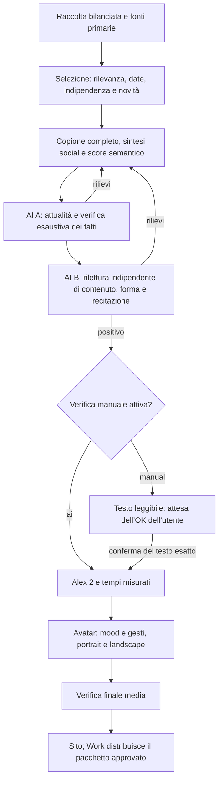

# CDaily — testo prima del video

Decisione dell’utente del **25 ottobre 2026**. Questo aggiornamento prevale sui vecchi clock da quattro/cinque minuti e sul precedente avvio automatico dei media. Lo stile visivo approvato rimane quello dello [standard di produzione](cdaily-production-standard.md).

## Promessa editoriale

**Meno rumore, più contesto.** Notizie spiegate a un pubblico curioso e non specialista, con ritmo agile e linguaggio amichevole. L’edizione Italia ha un baricentro italiano: decisioni pubbliche, economia, lavoro, salute, società, servizi, conoscenza e risultati di rilievo. Nessuna categoria deve essere riempita per forza.

L’estero entra per conseguenze italiane documentate oppure come eccezione per un evento mondiale davvero importante, motivata nel dossier. Non inventare un collegamento con l’Italia per ammetterlo. World rimane un prodotto distinto in inglese.

**Obiettivo cinque–sette minuti**, minimo **sei notizie**, normalmente sei–otto e massimo nove. Il master misurato deve durare **almeno 4:30 e meno di 10:00**, inclusi apertura, pausa e saluti. Profilo `editorialProfile: italia-morning-v2`, separato dall'identità video: gli snapshot precedenti mantengono le soglie originali. Il bacino di ricerca mira a 14 candidate, massimo 18, prima della verifica e della selezione finale. Se mancano sei notizie solide al primo giro, il recupero automatico conserva le valide e cerca le mancanti nel secondo, poi nel terzo giro se necessario; solo dopo l’esaurimento del budget registra un problema operativo da correggere; mai aggiungere riempitivi. Niente rallentamenti, lettura precipitosa o silenzi per raggiungere il minimo. Filtro scritto 780–1.350 parole, stima normale circa 800–1.150; il take reale determina il minutaggio. [Politica di selezione, eccezione scientifica e motivi degli scarti](cdaily-selection-policy-20261025.md).

## Struttura del parlato

1. Saluto a tutti, nome, claim e giorno/mese effettivi, in pochi secondi. Esempio del 25 ottobre: **«Ciao a tutti, è Conclavia Daily. Meno rumore, più contesto. Oggi è il venticinque ottobre.»** La data è generata dai metadati nel fuso Europe/Rome; mai copiata da un vecchio video.
2. **Due secondi reali di pausa pulita** prima della prima notizia. È regia, non una frase da leggere. Nessun impatto sonoro o musica sotto le notizie.
3. Notizie con pesi diversi e percorsi narrativi liberi. Accaduto, rilevanza e possibili sviluppi sono domande interne, non passaggi obbligatori: includere soltanto contesto necessario e documentato. Spiegare le sigle indispensabili; non imporre previsioni, riepiloghi conclusivi o un numero di frasi. Non presumere che il pubblico conosca il fatto precedente.
4. Transizioni brevi e variate. Niente «seconda storia», «ieri sera» come presentazione del programma, ripetizione del sommario o lezioni sulle procedure di verifica. Una data precedente resta corretta quando è la data vera dell’evento.
5. Fonti/approfondimenti sul sito, invito ai commenti e alle richieste, follow, saluto finale: **«Fonti e approfondimenti su daily.conclavia.me. Scrivici nei commenti cosa vuoi approfondire: partiamo dalle tue domande. Segui Conclavia Daily. Ciao a tutti, a domani!»** Un solo gesto verso il basso, ancorato alla parola misurata «commenti».

Nessuna opinione libera AI ricorrente è stata approvata. Distinguere fatti, dichiarazioni attribuite e interpretazioni. Non promettere neutralità infallibile perché la produzione usa AI. Un titolo corretto non salva un testo poco chiaro, ripetitivo o sbilanciato.

**Revisione narrativa del 26 ottobre:** Alex resta giovane, amichevole, sciolto, credibile ed espressivo. Citare le testate nel parlato quando serve a conservare attribuzione e grado di certezza, soprattutto per accuse, ricostruzioni, dichiarazioni e interpretazioni; la tracciabilità completa resta nei metadati. B mantiene tutti i controlli fattuali e può bloccare anche per ripetitività sostanziale, contesto indispensabile mancante o parlato artificioso, indicando i passaggi concreti. Nessuna scaletta narrativa imposta a ogni notizia e nessun nuovo stadio della pipeline. Il formato pubblico dello score resta identico. Nella sola richiesta interna al modello sono rimossi i minimi per notizia di segmenti lunghi: le clausole seguono il significato entro il tetto tecnico pubblico, mentre restano i filtri di profondità e copertura dell’intero copione. Nessun numero obbligatorio di frasi grammaticali. I criteri comuni effettivamente usati da writer/B sono in `src/lib/tg/narrative-policy.ts`; entrano nell’impronta di B, per richiedere una nuova verifica quando cambiano. [Confronto sul copione del 26 ottobre](cdaily-narrative-revision-20261026.md).

Per i giri ordinari partire dalla [pagina rapida](cdaily-quick-start.md) e dal contesto locale generato con `npm run daily:context`. Questo documento resta il riferimento completo; la [nota sul riuso locale](cdaily-text-local-first.md) distingue le ottimizzazioni attive dagli sviluppi da qualificare.

**Pertinenza del contesto — ulteriore rifinitura del 26 ottobre:** il pubblico è generalista adulto, senza conoscenze specialistiche presunte. Scegliere il contesto che cambia la comprensione della notizia concreta: un ruolo indispensabile, una relazione fra i protagonisti, l’origine documentata di una vicenda, la decisione in gioco, un confronto significativo o un limite sostanziale delle prove. Sono possibilità, non uno schema da applicare tutto e nello stesso ordine. Usare una prova di rimozione: senza quel passaggio rimarrebbe un equivoco importante? Non spiegare concetti quotidiani ovvi al posto delle informazioni essenziali; chiarire un termine soltanto quando serve a capire quel fatto, preferibilmente dentro il racconto concreto. Più spiegazioni, parole o tecnicismi non sono automaticamente un miglioramento.

B valuta esplicitamente naturalezza del parlato, ripetitività, pertinenza del contesto e frasi prive di contributo informativo o di una funzione narrativa utile. Usa i campi esistenti `form`, `coherence` e `coverage`, insieme agli invariati controlli fattuali e di `delivery`; niente nuovo passaggio o rapporto. Indicare la lacuna precisa o il passaggio superfluo, non chiedere genericamente di ampliare ogni notizia. Una transizione breve, una qualificazione necessaria, una formulazione espressiva o la sigla del programma possono avere una funzione utile anche senza introdurre un nuovo fatto. La regola non è un filtro lessicale. Le istruzioni di produzione restano generali, senza esempi tratti da singole notizie.

La proporzione emotiva non significa recitazione uniformemente attenuata: Alex mantiene calore, curiosità, energia e coinvolgimento giovanile quando appropriati. Nessuna riduzione automatica delle intensità, conversione dei mood in attenzione neutra o soppressione delle gesture già concordate. Il planner e i tempi misurati restano gli stessi. [Verifica della rifinitura](cdaily-context-relevance-20261026.md).

## Raccolta e verifica delle fonti

Catalogo corrente: **38 feed complessivi, 31 per Italia**, con **21 gruppi editoriali/origini dichiarati** nel registro italiano. Comprende Rai, ANSA, AGI, Adnkronos, Euronews, Il Sole 24 Ore, la Repubblica, TGcom24, Open, Governo e Istat. I dieci feed ANSA sono una sola origine, così come due URL della stessa testata o due copie della stessa agenzia. Il catalogo non è il numero di fonti consultate da ciascuna edizione. Il 25 ottobre sono stati aggiunti Il Fatto Quotidiano, Today, il manifesto, Domani, Libero, Quotidiano Nazionale, Il Messaggero, Punto Informatico, Quotidiano Sanità e HDblog, più sport/cultura ANSA ed economia del Sole. [Verifica operativa degli endpoint](cdaily-source-expansion-20261025.md).

Il collaudo del 25 ottobre ha raccolto 411 voci RSS, poi bilanciate per editore e sezione: **411 candidate non significano 411 notizie verificate**. Non aggiungere feed rotti o vecchi solo per far crescere il numero: Corriere fermo al 2024, Sky 410 e Il Post 403 sono stati esclusi dalla raccolta provata. Conservare diagnostica e data di verifica privatamente.

Per ciascun fatto centrale servono riscontri attuali di almeno due origini distinte sullo **stesso evento**, ricerca web separata e fonte primaria quando disponibile. Un comunicato prova che qualcuno ha dichiarato qualcosa; da solo non prova tutte le sue conclusioni. La documentazione istituzionale aiuta su norme, numeri e stato dei provvedimenti; non sostituisce il confronto editoriale. Reddit e tendenze indicano piste, non costituiscono prove.

Lo sviluppo deve essere nuovo nella finestra delle ultime 24 ore e rispetto all’archivio realmente pubblicato. Riscontri entro 36 ore; materiale precedente solo come contesto dichiarato. Distinguere evento, annuncio, aggiornamento della pagina e prima pubblicazione di uno studio. Un tema importante può tornare con una vera evoluzione: spiegare prima che cosa cambia, poi il minimo contesto datato. Un’analisi ripubblicata o un titolo riformulato non sono novità. Anche due slot della stessa puntata che raccontano lo stesso evento vanno accorpati.

Ogni candidata conserva: URL, editore/origine, data, estratto effettivamente acquisito, sviluppo verificato, rilevanza per il pubblico, incertezze, confronto con il pubblicato ed esito di ammissione/esclusione. Nessuna data o precisione temporale inventata per superare il controllo.

**Precisione temporale proporzionata — decisione del 26 ottobre:** non chiedere sistematicamente l’ora esatta del voto o dell’evento. Data, parte della giornata e cronologia documentata possono bastare: un congresso concluso nel pomeriggio precedente rientra normalmente nella finestra di un’edizione mattutina senza conoscerne il minuto. Servono ulteriori riscontri temporali quando l’incertezza può cambiare davvero l’ammissione al limite delle 24 ore o rispetto all’ultima edizione pubblicata; un dubbio materiale irrisolto resta bloccante. Non dedurre l’orario dell’evento dalla sola pubblicazione della pagina. Un annuncio nuovo nella finestra può essere raccontato come annuncio, anche se il passaggio previsto è ancora futuro; non esigere che sia già avvenuto e non presentarlo come compiuto. L’annuncio può risalire al giorno precedente entro la finestra, non deve necessariamente essere stato pubblicato “oggi”. Restano identici finestra mobile, riscontri indipendenti e divieto di riciclare vecchi fatti invariati. Ricerca, selezione e A/B condividono `DAILY_TIMELINE_POLICY`.

## Pipeline e conferma manuale



**Il controllo manuale è configurabile e attualmente attivo.** In `config/tg/daily-agent.json`, dentro `product`:

```json
{
  "productionMode": "full",
  "textReviewMode": "manual"
}
```

`manual` aggiunge l’OK dell’utente **dopo entrambi i controlli AI e prima dei media**. Cambiare soltanto `textReviewMode` in `ai` (oppure ometterlo) ripristina la prosecuzione automatica: raccolta, formato del copione, mood/gesture, controlli A/B e revisione finale rimangono gli stessi. Un esito negativo di A o B blocca anche con verifica manuale disattivata. Non creare una ricevuta umana a partire da un verdetto AI.

La stessa opzione è nel desk **Redazione → Edizioni e canali → Verifica manuale del copione**. Per applicare un file modificato al backend eseguire `npm run daily:agent -- configure`; la UI salva direttamente la configurazione persistente. L’avvio Mac alle 07:30 rimane invariato. Le edizioni già create conservano il loro snapshot: cambiare la configurazione non approva né sblocca retroattivamente un copione in attesa.

`productionMode: editorial` e il limite runtime `TG_EDITORIAL_ONLY=true` restano arresti tecnici separati: fermano sempre la produzione dopo il testo, anche con `textReviewMode: ai`. Nel normale percorso completo il solo interruttore della verifica umana è `textReviewMode`.

Il modello editoriale è esplicito nel piano: `editorialModel: gpt-5.4`, applicato soltanto al processo Daily. La configurazione delle altre funzioni Meeting rimane distinta. Il modello effettivo entra nelle chiavi delle cache del laboratorio; non riusare un esito prodotto con un’altra configurazione come se fosse una nuova verifica.

A controlla tutti i segmenti, titoli, cartelli e sintesi; B legge il medesimo parlato completo con score e prove, senza ricevere il verdetto di A. Conservare rapporti positivi e negativi, errori tecnici e versioni precedenti. Un errore di API non è un giudizio positivo. Le citazioni scientifiche NEJM vengono controllate nei metadati pubblici Crossref: un DOI esistente ma riferito a un’altra pubblicazione, oppure senza identità verificabile rispetto al titolo acquisito, viene escluso dai riscontri utilizzabili. Questo controllo riguarda l’identità bibliografica, non certifica il metodo scientifico o tutti gli altri siti. Conservare la versione precedente delle prove e rifare A/B dopo una correzione. Le cache legano anche prove, ricerca, data e profilo, non soltanto le parole. Correggere i rilievi, non ripetere il controllo alla ricerca di un sì.

Il nuovo rapporto A registra ciascun rilievo sul target preciso come `unsupported` o `unverifiable`, con motivazione e prove; qualunque target negativo blocca il passaggio. Una nota positiva non va inserita fra i problemi bloccanti. I vecchi rapporti con rilievi liberi restano conservati e mantengono il loro esito. Quando parte una nuova revisione, la precedente consegna da approvare viene archiviata privatamente e sostituita da «revisione in corso»: nessun vecchio dossier positivo deve sembrare quello corrente.

Il laboratorio privato richiede esplicitamente al massimo dodici riscritture automatiche persistenti per sessione; il ciclo ordinario mantiene il proprio budget di una correzione, identico con verifica manuale attiva o disattiva. Il job storico del primo ciclo mantiene i propri contatori. La cifra è un limite operativo, non un obiettivo. Una nuova revisione esplicita del redattore può essere sottoposta ad A/B senza azzerare quei contatori; non abilita altre riscritture automatiche oltre il limite. Se il problema riguarda la selezione, cambiare realmente le prove/scaletta invece di riscrivere all’infinito lo stesso materiale. Le richieste con esito incerto non vengono automaticamente ripetute.

La ricevuta `textApproval` lega conferma esplicita, revisore, data, hash del copione completo e hash dello score. Con verifica manuale attiva, cambiare parole, titoli/sintesi, mood o intenzioni invalida la conferma; il testo aggiornato va ricontrollato e ripresentato. Questo vale anche per una riscrittura del minutaggio dopo il primo take: nuova verifica A/B e nuovo OK prima di una seconda sintesi. I controlli di attualità vanno rinnovati quando scadono: un’approvazione manuale non rende fresche notizie vecchie. Non trasformare automaticamente un testo di oggi in una puntata di domani.

La GUI privata espone **Testi verificati → Conferma del copione → Conferma testo e avvia produzione**. Servono il nome del revisore e la spunta esplicita dopo la lettura. L’azione `approve-text` controlla revisione concorrente, lease, data/finestra, hash del testo e input del revisore B, attualità A/B e archivio del pubblicato; accoda la stessa edizione con ricevuta manuale senza azzerare tentativi o correzioni. Il timer del Mac riprende al controllo successivo. Nessun media è approvato da questo pulsante: la revisione finale AI rimane distinta. Se i controlli sono scaduti usare **Richiedi nuova verifica**, poi rileggere e confermare; l’edizione resta bloccata oltre la finestra odierna. Le sessioni del laboratorio locale rimangono separate dai job del database.

Superati i controlli configurati (incluso l’OK se `manual`), si prepara il take Alex 2, si misura la durata reale e si genera il video nei due formati nativi. Restano i controlli finali su testo/audio, giunzioni, mani, volto, leggibilità e pubblicazione. Il sito ospita solo presentazione approvata e vere edizioni rilasciate. Work legge il pacchetto odierno dal sito; l’orario delle 08:15 è un obiettivo subordinato ai controlli e all’eventuale OK manuale, non un permesso di saltarli.

## Mood e gesti

Ogni clausola conserva `text`, `mood`, `intensity`, `intent`, `storyId`, `speaker` e `sourceIds`. Lo score testuale è derivato da questa rappresentazione unica e resta separato dalle parole da pronunciare. Una frase può attraversare più atteggiamenti quando cambia significato; una notizia non riceve un solo mood fisso.

Mood: attenzione, curiosità, dubbio reale, empatia, accordo relazionale, sorpresa motivata; disaccordo e divertimento solo se appropriati al contenuto. Mai sorriso su sofferenza, enfasi di parte o rassicurazioni senza prove. Non usare tutto il catalogo per esibire varietà.

Le intenzioni sono spiegare, chiedere, confrontare, sottolineare, rassicurare con misura, invitare, riflettere e riconoscere. Il planner condiviso sceglie un gesto compatibile oppure quiete, con memoria delle famiglie recenti. Coordina mani/dita, polsi, braccia, spalle, busto, collo e sguardo; preparazione, accento e rilascio sono continui. Palmi uniti verso il petto e tocco al mento sono accenti occasionali, non reazioni preassegnate a terremoti o categorie. Intreccio solo da seduto. Il puntamento sui commenti è l’unico gesto obbligatorio.

Prima dell’audio non inventare timestamp, fonemi, velocità del labiale o durate dei gesti. Il take vero governa tutti i tempi. Conservare grafica, font, studio, voce e rig approvati; questa revisione è editoriale e non rigenera il personaggio.

## Consegna da leggere prima del video

- Copione intero: apertura, tutte le notizie e chiusura, senza marcatori pronunciabili.
- Titoli e scaletta in ordine; stima di lettura dichiarata come stima.
- Fonti per notizia, contesto, sviluppo nuovo, eccezioni mondiali ed esclusioni motivate.
- Tabella mood/intenzioni e score verificato; nessun audio necessario per approvarne il significato.
- Sintesi social autonoma nella lingua dell’edizione, che copra tutte le notizie senza nuove affermazioni. Il publisher riusa quella controllata.
- Rapporti A/B reali, hash della versione e stato **in attesa dell’OK dell’utente**.

Laboratorio privato riprendibile:

```sh
npm run daily:editorial
```

Produce materiali in `.tg-artifacts/editorial/AAAA-MM-GG/` e il dossier leggibile in `docs/tg/editions/AAAA-MM-GG-it-editorial-review.md` solo dopo A/B positivi. Non dispone di porte per voce, rendering o pubblicazione. Una revisione motivata della selezione si passa come JSON privato nella stessa cartella datata; conserva storia e contatori. La conferma dell’utente avviene dopo la lettura del dossier, non con il comando di preparazione.
