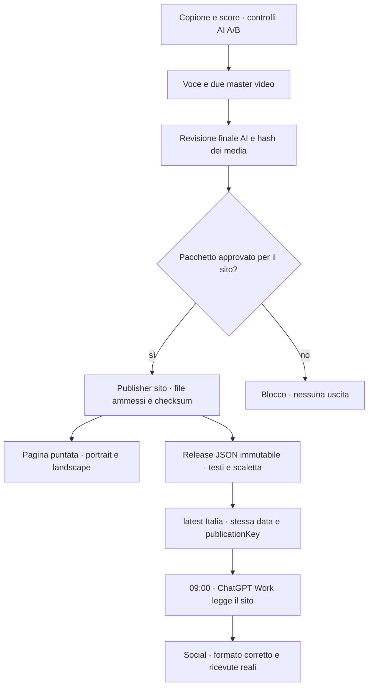

# CDaily — pubblicazione sul sito e consegna a Work

Decisione dell’utente del **24 ottobre 2026**: «pubblicalo in automatico sul sito sia portrait che landscape poi il worker lavora dal sito». Il sito diventa l’archivio pubblico e il punto di consegna; Work non deve più leggere la cartella del Mac o accedere al database per distribuire i video.

## Flusso implementato



È implementato e attivo **il tratto dal pacchetto completo e approvato al sito**. La produzione schedulata resta per ora `editorial`: questo lavoro non risolve né abilita automaticamente il percorso voce/render del Daily. Le demo non possono sostituire una puntata approvata per i social.

## URL e contratto

- Archivio pubblico: <https://daily.conclavia.me/edizioni/>; pagina inglese <https://daily.conclavia.me/en/editions/>.
- Catalogo: <https://daily.conclavia.me/edizioni/index.json>.
- Punto d’ingresso Work Italia: <https://daily.conclavia.me/edizioni/it/latest.json>.
- Demo reale pubblicata nei due formati: <https://daily.conclavia.me/edizioni/demo/2026-10-24/>.
- Puntate future: `/edizioni/it/YYYY-MM-DD/` oppure `/edizioni/world/YYYY-MM-DD/`.
- Ogni revisione conserva file e `release.json` sotto la propria impronta. `latest` contiene un riferimento al JSON immutabile, non a un file locale modificabile.

Il JSON espone solo titolo, descrizione, data, lingua, scaletta, copione pubblico, fonti citate, caption per piattaforma e URL/impronte/dimensioni dei file. Nessuna configurazione privata, dettaglio dei revisori, credenziale, ID account interno o manifesto grezzo del backend. La caption include l’URL univoco della puntata, utile per la riconciliazione dei post.

`kind=waiting` significa che non esiste ancora una puntata. `kind=demo` ha `distribution.eligible=false` ed è escluso da `latest`. Solo `kind=daily` con data odierna, approvazione AI corrispondente, finestra valida e file completi è utilizzabile da Work.

## Approvazione e atomicità

`siteFirst=true` è una scelta dell’applicazione, separata dal kit avatar. La revisione AI del sito non richiede di fingere che siano già configurate le credenziali social native: usa `review.scope=website`, destinazione HTTPS del progetto e un digest che include prodotto, testo, score, fonti, verifiche, media e copy social. A/B e revisore finale restano obbligatori. Una modifica invalida l’approvazione.

Il publisher ricontrolla archivio/freschezza, stato, data e finestra; copia soltanto `portrait.mp4`, `landscape.mp4`, `audio.mp3`, `captions.vtt`, poi verifica i byte. Il manifesto privato non viene copiato. Prima della visibilità finale rilegge lo snapshot del job. Indice e pagine sono scritti atomicamente; il catalogo è il commit della pubblicazione. Un hash alterato o un’approvazione cambiata ferma l’uscita. Le esecuzioni sono serializzate dal `flock` del servizio.

Una ricevuta `sitePublication` distinta congela le affermazioni realmente pubblicate: una bozza successiva non riscrive questa memoria. La ricevuta entra nell’archivio delle notizie già pubblicate anche prima delle uscite social. Non segna fittiziamente YouTube o Spotify come pubblicati. L’outbox nativa esclude `siteFirst`: Work non deve fare un secondo invio tramite il vecchio CLI.

## Host e deploy verificati

- Servizio `conclavia-daily-site.service`, timer `conclavia-daily-site.timer`: installati, attivi e abilitati all’avvio; controllo ogni minuto.
- Release publisher: `site-1792875880377-a7519222`; database verificato con il runtime reale.
- Archivio persistente: `/opt/conclavia/web/editions`, già compreso nel volume del gateway. I deploy grafici e i rollback del sito non cancellano le puntate.
- Artefatti privati montati in sola lettura da `/opt/conclavia/daily/data`. Pubblico separato, nessuna porta aggiunta e nessuna chiave AI/voce/social nel publisher.
- Redazione aggiornata: `editorial-20261024204925120-3f975e30`; `siteFirst=true` sul prodotto Italia, **productionMode=editorial conservato**, snapshot dei job già esistenti non riscritti.
- Rilascio sito: `web-20261024205110012-6f5aec`. Primo aggiornamento con reload Caddy, successivo aggiornamento senza restart/reload. Meeting e Onboarding invariati.

Comandi in `../conclavia-deploy`:

```sh
npm run conclavia -- daily-site status
npm run conclavia -- daily-site deploy
npm run conclavia -- daily-site configure
npm run conclavia -- daily-site import-demo
```

`configure` cambia soltanto `siteFirst` sulla configurazione Italia già esistente; non abilita media o social. `import-demo` richiede il pacchetto dimostrativo esplicito, whitelist/checksum e blocco di distribuzione; non crea un’approvazione AI di notizie.

## Verifiche

141 test Daily positivi, inclusi Mongo temporaneo esplicito `127.0.0.1:27018` e outbox. Quattro verifiche specifiche: legame dell’approvazione sito, whitelist/escape pubblico, corruzione o modifica prima del commit, idempotenza e memoria delle uscite web. Nessun provider a pagamento nei test. Typecheck/lint dei nuovi moduli positivi.

Deploy: 65 test Node, 54 Python e integrazione Caddy reale positivi. Verificate route sito, range HTTP dei video, file nascosti e protezione della gestione. Sito: suite IT/EN a otto larghezze positiva. Entrambi gli MP4 della demo scaricati realmente via HTTPS: impronte e dimensioni corrispondenti, range `206` funzionante. La demo rimane distinta dalle notizie.

La task Work non è certificata da questi test. Prompt aggiornato in [cdaily-work-publication-task.md](cdaily-work-publication-task.md): sorgente pubblica, data, finestre, destinatari, riconciliazione e nessuna copia di ieri. Le ricevute dei connettori Work restano nella task e nei servizi, finché non sarà aggiunto un adattatore dedicato verso il registro backend. Il controllo della UI locale continua a restituire `Sky Computer Use native pipe startup failed`: nessun salvataggio di task è stato dichiarato senza evidenza.

Verifica live finale: player attivo senza mute a 390/1440 px, passaggio tra i due formati, nessun overflow o errore browser; log privato in `../conclavia-web/.local/site-handoff-20261024/`. Ultimo ciclo automatico del publisher: `Result=success`, `ExecMainStatus=0`; la lettura del runtime conferma database connesso, generazione/social disabilitati.

Verifica di recupero: il catalogo già committato permette di ricostruire la ricevuta DB verificando snapshot e byte anche dopo la chiusura della finestra. Questo riconcilia una pubblicazione realmente avvenuta, senza autorizzare un nuovo invio tardivo. Build di produzione Meeting positiva in una directory separata; 17 integrazioni outbox positive, inclusa l’esclusione `siteFirst` dal trasporto nativo.
