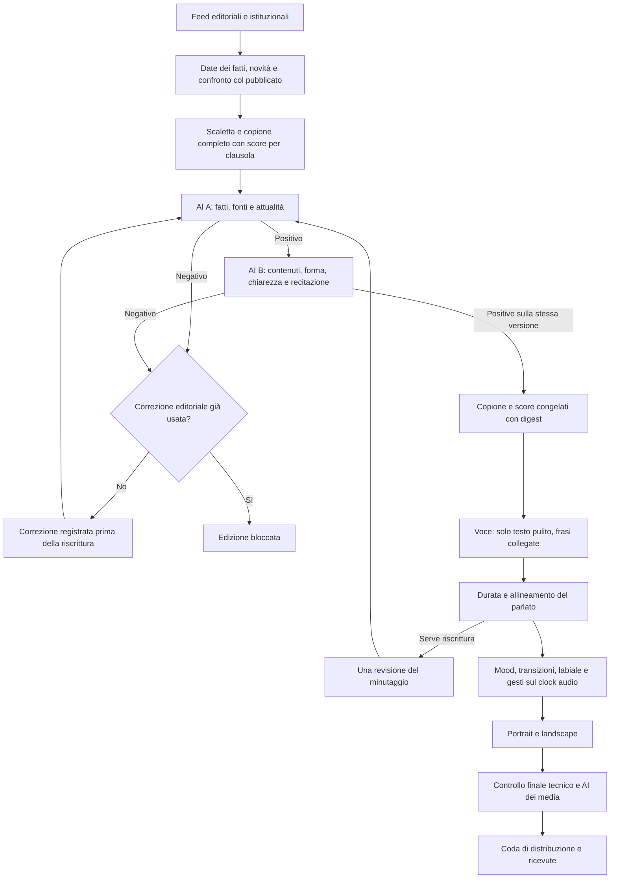

# CDaily — copione, score espressivo e doppio controllo prima dei media

Revisione avviata il 23 ottobre 2026, verificata nella notte del 24. Richiesta implementata: ampliare la raccolta e verificare con due giudizi AI separati il testo che diventerà l’audio, compresi forma e recitazione. Non è una nuova edizione né un’attivazione dello scheduler.

## Pipeline



Il conteggio delle correzioni editoriali e del minutaggio è persistente nel job. Una ripresa tecnica non concede altre riscritture. Un nuovo controllo mancante, negativo, scaduto o riferito a un’altra versione impedisce voce/render. La GUI consente una nuova revisione esplicita, senza trasformare un vecchio esito in approvazione della copia modificata.

## Il testo verificato è il testo da leggere

Il writer restituisce il contratto strutturato esistente: testo, parlante, notizia, fonti, mood, intensità e intento per clausola. Da questa stessa struttura si compila la rappresentazione leggibile:

```text
<mood:curiosity intensity="0.6" intent="explain">Il risultato è interessante,</mood>
<mood:doubt intensity="0.4" intent="reflect">ma servono ulteriori verifiche.</mood>
```

Esempio dimostrativo, non una notizia. `fun` è un alias di scrittura di `amusement`; non autorizza ironia su fatti gravi. I mood canonici restano `attention`, `curiosity`, `doubt`, `agreement`, `amusement`, `empathy`, `disagreement`, `surprise`.

Il testo pulito è «Il risultato è interessante, ma servono ulteriori verifiche.» La voce non riceve i marcatori dello score. I passaggi della stessa notizia e dello stesso parlante restano paragrafi collegati; cambiare mood non introduce una chiamata vocale o una pausa per ogni clausola. Istruzioni tecniche del provider, dove già previste dall’adattatore, rimangono distinte dal testo pubblico.

Il parser/formatter è riutilizzabile da `@conclavia/avatar-kit/performance`, con API documentate nel kit. La compilazione editoriale, le fonti e i revisori appartengono a Meeting. Il writer sceglie significato e atteggiamento; il motore sceglie gesto compatibile oppure quiete. Non scrivere «preghiera sul terremoto» o un’associazione per categoria. Palmi e mento usano le pose approvate; il puntamento verso i commenti resta applicativo e si ancora alla parola misurata.

I secondi delle transizioni non vengono inventati dal writer: dopo la voce il piano corporeo continuo usa i segmenti misurati. Preparazione, accento, tenuta e recupero rimangono quelli dell’engine condiviso, insieme alla memoria dei gesti. Un fallback stimato nell’allineamento conserva la propria etichetta: la nuova verifica del testo non certifica una precisione fonetica non misurata.

## Due controlli distinti

**AI A** conserva il controllo di fonti, affermazioni, cartelli, titolo, riassunto, freschezza e novità rispetto alle pubblicazioni confermate. Ricerca web separata dalla selezione iniziale.

**AI B** riceve copione completo nell’ordine effettivo, testo pulito, score, prove RSS e ricerca web realmente recuperata. Non riceve il verdetto dello scrittore o il giudizio A da ricopiare. Può usare lo stesso provider: separazione dei ruoli e delle chiamate non significa eliminazione garantita dei bias.

Per **ogni clausola** B deve esprimersi su contenuto, forma parlata e recitazione, motivando il risultato. Deve inoltre controllare coerenza complessiva, imparzialità del trattamento, apertura datata, chiusura e copertura. Mancano voci o motivazioni? Il rapporto è invalido. Un negativo blocca o richiede l’unica correzione; non viene convertito in positivo perché A aveva approvato.

Il rapporto B conserva testo pulito, score e digest di copione, data, prodotto e materiale di ricerca. Cambiare una parola, mood, intento, fonte o data invalida il legame. Il rendering confronta anche il testo dei cue del master vocale con il copione verificato. Dopo la voce una riscrittura per la durata richiede nuovamente A e B. Anche approvazione e distribuzione richiedono il secondo rapporto valido; una checklist umana non lo sostituisce.

## Apertura con la data

Il writer ora usa il saluto datato derivato dal giorno dell’edizione, non dall’istante del rendering:

> Ciao, questo è Conclavia Daily. Oggi è il ventiquattro ottobre.

L’esempio è per `2026-10-24`; la data cambia con i metadati. Il nuovo worker passa la propria data congelata al writer, comprese le riscritture. Sono verificati calendario valido, lingua, idempotenza del saluto e sostituzione di un vecchio saluto datato senza duplicazioni. Le chiamate storiche senza data conservano la compatibilità.

## Catalogo ampliato

**14 feed configurati: sette Italia, sette World**, cinque aggiunti. Non significa che una puntata abbia consultato 14 fonti o che ciascun feed abbia un articolo attuale.

| Nuovo feed | Edizione | Uso |
| --- | --- | --- |
| [AGI](https://www.agi.it/cronaca/rss.xml) | Italia | Cronaca e sviluppi nazionali. |
| [Il Sole 24 Ore](https://www.ilsole24ore.com/rss/italia.xml) | Italia | Informazione italiana, con ulteriore copertura economica. |
| [Istat](https://www.istat.it/altri-servizi/feed-rss/) | Italia | Comunicazioni e dati primari. |
| [BCE](https://www.ecb.europa.eu/home/html/rss.en.html) | World | Titoli e date dei comunicati primari; il feed non fornisce il corpo. |
| [NASA](https://www.nasa.gov/news-release/feed/) | World | Comunicazioni scientifiche primarie. |

Tutti e cinque hanno risposto HTTP 200 e sono stati sottoposti al parser reale. Il [rapporto](cdaily-new-source-verification-20261023.json) registra anche quanti elementi superano i filtri del parser e della finestra temporale. La BCE pubblica solo titoli: questi sono marcati `HEADLINE ONLY; no article body retrieved`, senza un riassunto inventato, e sostengono soltanto quanto il titolo afferma. I dettagli devono ricevere ulteriori riscontri prima della voce. Un feed accessibile può avere zero elementi utilizzabili: non si allenta la freschezza per riempire la scaletta.

La selezione bilancia gli editori con un catalogo limitato: massimo 16 elementi per editore e 180 complessivi per passaggio. Lo schema evita di moltiplicare tutte le coppie di fonti; l’indipendenza delle due origini viene verificata sul catalogo immutabile prima di accettare la ricerca. Copie di agenzie attribuite in autore o campo `source` non diventano riscontri indipendenti. Una fonte primaria prova ciò che dichiara, non rende automaticamente corrette tutte le interpretazioni successive.

## GUI e stato operativo

La redazione mostra A e B separatamente, motivazioni per clausola, testo da leggere e score in sola lettura. Il pannello della produzione distingue copione/score, doppio controllo, voce/video e revisione finale. Un secondo controllo assente disabilita l’approvazione anche con A positivo.

Il worker usa questi gate; la prova italiana che richiama `produceTg` li usa anch’essa. Gli strumenti storici di laboratorio che chiamano direttamente sintesi/render non sono una filiera autonoma validata. Le nuove prove di questa revisione usano provider simulati e Mongo temporaneo; non generano una puntata, audio AI o pubblicazioni.

La voce approvata resta Alex 2. L’adattatore automatico preesistente continua però a usare Inworld: questa revisione dei controlli non realizza l’integrazione API di Alex 2. Restano da collaudare la produzione reale completa, i tempi/fedeltà dell’audio e l’operatività dei canali. Non dichiarare il Daily di domani già generato o programmato.

## Verifiche completate

236 test del kit e 94 test TG superati. Le 15 integrazioni della coda sono state eseguite separatamente con `TG_INTEGRATION_TESTS=true`, sul Mongo temporaneo dedicato, e passano tutte: pubblicazioni e ricevute rimangono simulate. Passano 23 regressioni browser avatar/player e, nel collaudo finale separato, gli 11 test della redazione, incluso B mancante e il blocco API. Una fixture con configurazione modificata deve ora ottenere un nuovo rapporto B, come il prodotto reale.

Typecheck, lint interessato, confini delle feature/consumer e build Meeting/Onboarding passano. I 17 riferimenti grafici approvati coincidono con il lock. La [GUI verificata](../images/daily-editorial-pipeline-20261023/newsroom.png) conserva testo e dati dichiaratamente sintetici. Il [rapporto tecnico](cdaily-text-pipeline-verification-20261023.json) distingue chiamate ai feed reali da controlli AI simulati e prove con database temporaneo.

Anteprima locale aggiornata: [Redazione e pubblicazione](http://127.0.0.1:3107/podcast/tg/redazione). Aprire la pagina non avvia il worker o una pubblicazione.
