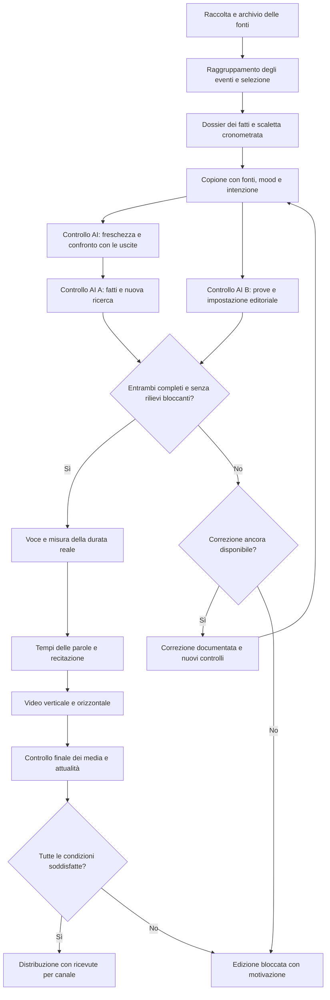

# CDaily: flusso editoriale e produzione giornaliera

**Aggiornamento implementato il 23 ottobre:** [pipeline del testo e dello score con doppio controllo AI](cdaily-text-production-pipeline-20261023.md), catalogo di 14 feed, data nel saluto automatico e contatori persistenti per le due riscritture. Questo aggiornamento supera le precedenti indicazioni che segnavano il revisore B o i contatori come mancanti; la filiera reale completa resta da collaudare.
Per una nuova edizione, lo [standard di produzione approvato il 23 ottobre](cdaily-production-standard.md) fissa l'identità da riusare e raccoglie le indicazioni dell'utente. I piloti precedenti sono archivio: non sono template di grafica, voce, apertura o selezione per una nuova uscita.

La [base consolidata del formato](cdaily-format-foundation.md) incorpora il pilota Italia r3 apprezzato dall’utente e la data pronunciata nelle prossime aperture. La [specifica di recitazione](cdaily-acting-direction.md) separa capacità esistenti, prove mute e sviluppo futuro del motore.

Revisione consolidata il 23 ottobre 2026. Specifica operativa ricavata dalle richieste
dell'utente: raccolta strutturata, fatti documentati, doppio controllo AI,
durata commisurata alla scaletta e successiva produzione del video. Questo documento distingue
le regole da raggiungere dalle funzioni già implementate; non attesta che
l'intero ciclo autonomo sia attivo. Non avvia pubblicazioni o nuove generazioni.

La [linea editoriale comune](cdaily-editorial-line.md), aggiornata dopo il
riesame del pilota r3, definisce pubblico, peso delle notizie, apertura,
transizioni e spiegazioni. Si applica a tutte le edizioni IT/World e prevale
sulle formule dei vecchi piloti. La grafica resta nella [guida video](cdaily-video-guide.md).

## Decisioni di formato — riesame successivo del 23 ottobre

- **Italia:** baricentro italiano; ammettere Europa/estero con interesse concreto documentato per il pubblico italiano o eccezione mondiale motivata. Il revisore B controlla la coerenza dell’intera selezione, oltre alla correttezza dei fatti.
- **World:** selezione globale autonoma in inglese; non traduzione o raccolta degli scarti italiani.
- **Durata e conteggio elastici come criterio editoriale.** Il vecchio obbligo di 5:00 e cinque notizie è superato. Ipotesi da provare: circa 4–6 minuti, con margine motivato verso 6–7; 5–7 notizie indicative, una o due più sviluppate e altre compatte. Nessuna quota da riempire; nessun tempo ottimale già dimostrato.
- Il clock segue le notizie e la comprensibilità. Non allungare con silenzi, non tagliare contesto né accelerare la voce per arrivare a una durata convenzionale.
- Apertura breve con giorno e mese pronunciati dai metadati dell’edizione, pausa reale di 1–2 s, voce agile, nessuna musica sotto le notizie, chiusura fissa e indice verso i commenti. Stile, studio e avatar restano approvati. Prima della voce controllare la concordanza della data con manifesto, pagina e testo social.
- Puntata completa e clip social sono prodotti di distribuzione distinti: il formato verticale non rende automaticamente breve una puntata.

[Criteri, fonti e stato tecnico](cdaily-italia-world-duration-review-20261023.md). Il worker conserva ancora durata configurata e controlli di conteggio: l’elasticità è una revisione editoriale da implementare end-to-end, non una funzione già attivata da queste note. Il flusso di controlli sotto resta valido; i riferimenti numerici successivi descrivono il precedente collaudo.

## Flusso

Il ritorno di correzione è consentito **una sola volta**, non è un ciclo fino
all'approvazione. Una seconda verifica negativa blocca la puntata. La riscrittura
per la durata ha un solo tentativo distinto e richiede nuovamente entrambi i
controlli editoriali; non riapre i tentativi di correzione già consumati.

## 1. Raccolta e selezione

Obiettivo: raccolta periodica durante la giornata; composizione dell'edizione
nella finestra del worker, attualmente 45 minuti prima dell'uscita. La raccolta
continua è un'estensione prevista: oggi il catalogo viene raccolto nel job.

| Passaggio | Regola | Risultato conservato |
| --- | --- | --- |
| Acquisizione | Feed e pagine consentite, agenzie, testate e documenti primari. Ricerca mirata per colmare lacune. Reddit e tendenze sono segnali da indagare, non prove del fatto. | URL, editore, origine dell'informazione, date, estratto realmente consultato, momento del recupero. |
| Raggruppamento | Un solo evento anche se ripreso da molti siti. Distinguere aggiornamenti, duplicati e copie della stessa agenzia. | Evento e fonti collegate, con gruppi originari distinti. |
| Attualità | Priorità agli sviluppi delle ultime 24 ore; riscontri attuali entro 36 ore. I sette giorni precedenti servono al contesto. Distinguere data dell'evento e data dell'articolo. | Data di riferimento e differenza rispetto alla precedente edizione. |
| Ammissibilità | Almeno due origini editoriali distinte per la storia centrale; documento primario quando disponibile. Controllare cosa ciascuna fonte sostiene davvero. | Fatti ammessi, attribuzioni, contraddizioni e informazioni escluse. |
| Gerarchia | Prima conseguenza pubblica e rilevanza per il pubblico dell'edizione, poi novità e utilità della spiegazione. La viralità da sola non dà priorità. | Motivazione sintetica per inclusione, ordine e tempo assegnato. |
| Varietà | Cercare ambiti diversi quando ci sono notizie rilevanti: società, economia, mondo, scienza, cultura. Una giornata dominata da un evento può giustificare una scaletta concentrata. | Motivazione dell'eventuale concentrazione, verificata dal revisore B. |

Due articoli che ripetono lo stesso comunicato non rendono indipendente la sua
affermazione. Il documento prova ciò che l'ente ha pubblicato; non dimostra da
solo tutte le conseguenze o la verità di una dichiarazione. Una previsione o
un'accusa resta attribuita anche quando è ripresa da più testate.

La correttezza fattuale non dimostra il peso editoriale. Il normale bollettino
meteo locale non occupa uno dei cinque spazi del TG generalista. Sono ammissibili
eventi con conseguenze eccezionali o minacce gravi e attuali documentate, anche
prima che ci siano danni: non basta elencare colori e scadenze. Il caso Liguria
del pilota r3 va escluso dalla nuova scaletta. Ogni scelta richiede una ragione
concreta legata al pubblico dell'edizione, non una formula generica di importanza.

Estensioni previste per rendere più robusta la selezione:

- Conservare, quando disponibili, una o due notizie di riserva con prove già
  raccolte, separate dalle cinque selezionate. Una sostituzione motivata rientra
  nell'unica revisione editoriale e richiede nuovi controlli A/B dell'intero copione.
- Tenere distinti la finestra delle notizie e i documenti di contesto: un documento
  primario precedente alla settimana non diventa falso perché vecchio, ma vanno
  controllati pertinenza, versione e validità rispetto all'affermazione usata.

### Controllo di attualità e ripetizioni implementato

Il worker carica i copioni **effettivamente pubblicati** della stessa edizione
negli ultimi sette giorni. Sono incluse le uscite parziali con una ricevuta
social confermata; sono escluse bozze, ricerche e tentativi falliti mai usciti.
La memoria usa le frasi andate in onda, non tutti i fatti nel dossier di ricerca.
Italiano e World hanno memorie separate.

Prima della scrittura un controllo locale richiede due origini attuali entro
36 ore, almeno una fonte nuova nelle ultime 24 ore e dopo l’ultima puntata,
ed esclude i fatti identici già trasmessi. La ricerca web indipendente deve
poi verificare **quando è successo il nuovo sviluppo**, distinguendolo dalla
data di pubblicazione o aggiornamento della pagina.

Un revisore AI distinto dalla selezione confronta semanticamente tutte le storie
con l’archivio e il copione, anche quando cambiano titolo, parole, URL o ID.
Assegna `new`, `update`, `duplicate`, `stale` o `unverifiable`. Solo i primi due
possono proseguire. Un aggiornamento deve indicare la storia precedente, il
fatto concretamente nuovo e i riscontri che lo sostengono. Un articolo fresco
che ricicla un vecchio evento, una data incerta o un bollettino scaduto bloccano
la scaletta prima della voce; non si risolvono parafrasando il vecchio testo.
Una nuova pubblicazione scientifica su dati storici può entrare come novità
della ricerca, dichiarando chiaramente il periodo dei dati e la data del rapporto.

L’esito è salvato nell’audit, legato a ricerca, copione e archivio. La redazione
mostra stato, sviluppo, data, prove e confronto per ogni storia. Il controllo
di attualità dura **al massimo un’ora**; le finestre delle fonti vengono
ricalcolate anche prima dell’invio. Se nel frattempo cambia l’archivio delle
puntate pubblicate, serve una nuova verifica. Le vecchie approvazioni prive
di questo controllo non autorizzano nuovi invii. «Rigenera» su un’edizione
bloccata rifà anche la raccolta, invece di riusare fonti ormai vecchie.

Questo è un controllo editoriale con vincoli verificabili, non una garanzia
che l’AI riconosca sempre ogni ripetizione o data errata. La selezione e la
verifica semantica richiedono ancora il collaudo su giornate reali; le regressioni
usano archivi, fonti, esiti AI e canali sintetici senza chiamate a pagamento.

Collaudo locale del 21 ottobre: 65 regressioni senza database e 15 prove di
integrazione sul solo MongoDB temporaneo `127.0.0.1:27018`, tutte superate.
Provider e social simulati; nessuna chiamata AI a pagamento. Compilazione,
TypeScript ed ESLint superati; interfaccia controllata a 1365 e 390 pixel con
[desktop](../images/tg-freshness/desktop-panel.png) e
[mobile](../images/tg-freshness/mobile-panel.png), usando dati dichiarati di prova.

## 2. Scheda strutturata di ogni notizia

Schema logico da usare per la selezione e rendere consultabile nella GUI:

| Campo | Contenuto |
| --- | --- |
| Identità | ID stabile, titolo, ambito, territorio, edizione. |
| Tempo | Data dell'evento, pubblicazione, recupero, ultimo controllo. |
| Novità | Fatto nuovo o aggiornamento; cosa cambia rispetto a ieri. |
| Prove | Fonti originali, gruppi indipendenti, passaggi consultati, documento primario eventuale. |
| Registro delle affermazioni | ID, testo, tipo, fonti e passaggi che lo sostengono, esito della verifica. |
| Limiti | Dati mancanti, versioni in conflitto, numeri provvisori, attribuzioni obbligatorie. |
| Scelta editoriale | Perché entra in scaletta, priorità motivata, secondi e budget di parole. |
| Copione | Testo, ID delle affermazioni, fonti, speaker, mood, intensità e intenzione comunicativa per ciascun segmento. |
| Riassunto social | Apertura breve e un punto per notizia, nella lingua dell'edizione; stessi fatti e limiti del parlato, verificati insieme. |
| Controlli | Rapporti A/B, motivi di esclusione, revisioni e impronte dei contenuti verificati. |

Tipi da distinguere esplicitamente: `fact`, `attributed_statement`, `ai_analysis`.
Il collegamento frase → affermazione → prova deve includere anche apertura,
titoli, cartelli, descrizione e testi social quando contengono informazioni.
Non basta che una fonte sia associata genericamente a tutta la notizia.

Ogni puntata comprende un riassunto scritto autonomo di circa 80–130 parole,
entro 1100 caratteri, in `TgScript.description`. Copre tutte le notizie in ordine,
senza informazioni aggiuntive, ed è verificato insieme al parlato. L'applicazione
aggiunge invito, sito, dichiarazione AI e fonti al testo per canale; non rigenera
una caption non verificata al momento dell'invio. Vedere la [linea comune](cdaily-editorial-line.md#9-testo-di-accompagnamento-di-ogni-daily).

Il modello attuale conserva già fonti, fatti, novità, incertezza e mood;
i tipi espliciti e il registro con ID delle singole affermazioni sono estensioni
da implementare, non campi già presenti nel contratto `TgScript`.

## 3. Fatti, dichiarazioni e lettura dell'AI

Il TG non adotta commenti politici delle testate come propria posizione. Una
dichiarazione di un soggetto può essere essa stessa notizia, ma va attribuita
e distinta dalla conferma del suo contenuto. Identico standard di prova per
partiti, governi, aziende e altri soggetti; nessuna falsa equivalenza tra una
tesi documentata e una smentita priva di riscontri.

**Decisione corrente:** un commento finale ricorrente non è attivo. L'eventuale
esperimento «Lettura dell'AI» di 10–15 s resta da discutere con l'utente, dentro
i 300 s e prima della chiusura fissa. Non aggiungerlo automaticamente ai copioni.

In un futuro esperimento approvato, l'opinione o lettura originale dell'AI va segnalata chiaramente come
**analisi dell'AI**, separata dai fatti e accompagnata da ragioni, fonti e limiti.
Non può aggiungere numeri, citazioni, intenzioni, nessi causali o previsioni
non documentati. Rientra nel tempo assegnato alla storia; non è un commento
obbligatorio e non serve a riempire il minutaggio. Nel TG di lancio si privilegiano
fatti e contesto; i podcast potranno ospitare analisi più estese.

L'assenza di revisione umana delle singole edizioni è una scelta di processo.
L'origine AI non dimostra assenza di errori o pregiudizi. Se il sistema non
riesce a risolvere una questione con prove sufficienti, sospende l'uscita.

## 4. Doppio controllo prima della voce

**AI A, verifica fattuale:** recupera riscontri separati dalla ricerca iniziale;
controlla ciascuna affermazione, nomi, numeri, unità, date, attribuzioni, titoli e
conseguenze dichiarate. Restituisce `supported`, `unsupported` o `unverifiable`
con prove consultate e motivazione. Una pagina non letta non è una prova.

**AI B, revisione editoriale e secondo controllo:** riceve il copione e le prove
in un contesto nuovo, senza il giudizio A nella prima valutazione. Ricontrolla
il fatto centrale di ogni storia, tutti i passaggi sensibili, contraddittori o
interpretativi, oltre a completezza delle verifiche, omissioni rilevanti,
certezza eccessiva, selezione, tono, analisi dichiarata e coerenza dei mood.
Può richiedere una ricerca aggiuntiva mirata. Ruolo e istruzioni sono distinti
dallo scrittore; l'uso di un altro modello/provider è auspicabile ma non basta
a rendere le verifiche infallibili.

Per procedere servono due rapporti completi e coerenti riferiti alla stessa
versione del materiale. Il disaccordo si risolve recuperando prove e correggendo
il testo, non contando i voti o facendo scegliere allo scrittore il giudizio più
favorevole. Esiti negativi e successive correzioni restano nel registro. Controllo
mancante, ricerca fallita o limite di budget raggiunto significano stop.

### Decisioni sui rilievi

Il rapporto del revisore deve separare i problemi bloccanti dai suggerimenti
facoltativi. Il numero di commenti non è una misura della qualità.

| Esito | Esempi | Azione |
| --- | --- | --- |
| Errore o prova insufficiente | Cifra errata, fonte non consultata, attribuzione mancante, conseguenza inventata, fatto centrale contraddetto. | Correzione o sostituzione entro il tentativo disponibile; nuova verifica. Se irrisolto, stop. |
| Disaccordo fra verificatori | A considera un fatto sostenuto, B trova un contrasto documentato. | Confrontare prove, date e ambito delle affermazioni. Non assumere che il testo più recente sia automaticamente più accurato. Nessun voto di maggioranza. |
| Suggerimento di stile | Sinonimo preferito, frase migliorabile ma chiara e corretta. | Registrare come nota senza bloccare o riscrivere automaticamente. Se si decide di cambiare il copione, rientra nell'unica revisione disponibile e richiede nuovi controlli. |
| Indisponibilità tecnica | Timeout, fonte temporaneamente irraggiungibile, servizio vocale non disponibile. | Tentativo tecnico limitato solo se non esiste un giudizio editoriale negativo da aggirare. Nessuna approvazione per assenza di risposta. |

Ogni correzione mantiene il rilievo originario e il punto modificato. I contatori
dei tentativi devono essere persistenti anche dopo un riavvio: il codice ora salva i limiti nel job prima delle riscritture: una correzione editoriale e una per il minutaggio, conservate anche alla ripresa. Una sospensione tecnica non deve azzerare il limite editoriale.

## 5. Scaletta dei cinque minuti

Distribuzione aggiornata il 23 ottobre per ampliare la copertura, con pesi variabili e totale **300 s**. Vedere [motivazione e dettagli](cdaily-five-news-format-20261023.md):

| Tempo | Contenuto | Indicazione di esposizione |
| --- | --- | --- |
| 0:00–0:18 | Saluto, orientamento e due o tre temi. | «Ciao, questo è Conclavia Daily.»; subito una ragione per restare. |
| 0:18–0:20 | Pausa reale, 2 s. | Respiro e recupero del gesto, nessuna musica, click o effetto. |
| 0:20–1:35 | Principale, 75 s. | Fatto nuovo, contesto non esperto e conseguenza documentata. |
| 1:35–2:23 | Seconda notizia, 48 s. | Passaggio sul tema, fatto e spiegazione. |
| 2:23–3:11 | Terza notizia, 48 s. | Esposizione adatta al materiale, senza formule ripetitive. |
| 3:11–3:59 | Quarta notizia, 48 s. | Stesso rigore, nessun bollettino ordinario di riempimento. |
| 3:59–4:47 | Quinta notizia, 48 s. | Un ulteriore tema sostanziale, non una coda di titoli. |
| 4:47–5:00 | Chiusura, 13 s compreso recupero. | Sito, commenti con indice in basso sulla parola misurata, domande e claim. |

Punto di partenza italiano: circa **800–830 parole complessive**, con ritmo
conversazionale agile intorno a 170 parole/minuto, da calibrare sul take
reale. World ha un budget proprio sulla voce inglese. I tempi includono
transizioni, pause, saluto, chiusura e recupero: la sigla facoltativa occupa
solo i primi quattro secondi già compresi nel totale. Lo spazio aggiuntivo
serve a spiegazioni documentate; non a ripetizioni o a recitare più lentamente.

La durata viene assegnata prima della scrittura e misurata dopo la sintesi.
Un copione troppo lungo viene accorciato, uno troppo breve viene sviluppato
solo con fatti e contesto verificati. Una sola riscrittura per il minutaggio,
poi nuovi controlli A/B. Niente frasi troncate, lunghe attese per riempire il
tempo o accelerazioni che rendano la voce innaturale. Tolleranza finale dei
video: 0,1 s, come nel controllo già implementato.

Il saluto include ora il giorno e il mese dell’edizione, in italiano o inglese. Il tempo reale è compreso nel budget dell’apertura, senza una durata fissa di due secondi per il saluto stesso. Il server inserisce il saluto datato prima delle revisioni A/B, con mood accogliente, senza duplicarlo nelle riscritture.
La chiusura è altrettanto stabile: «Scrivici nei commenti cosa vuoi approfondire:
partiamo dalle tue domande. Meno rumore, più contesto.»; World usa “Tell us in
the comments what you'd like us to explore. Let's start with your questions.
Less noise. More context.”. Il server riserva le parole di saluto e chiusura
prima della scrittura del corpo e aggiunge entrambi prima degli audit.
I tre segmenti finali conservano un'unica registrazione continua; passano da
curiosità ad accordo, con un solo gesto verso il basso sulla parola misurata
«commenti». Non si promette una risposta a ogni commento. L'invito non attiva
da solo un agente di raccolta o risposta sui social.
L'apertura ha ora un budget di 20 secondi: 18 s di parlato e 2 s di pausa reale prima della prima notizia; saluto, una breve
frase di orientamento, due o tre anticipazioni e ingresso nella prima notizia.
Il parlato dà contenuto e accoglienza; seguono i due secondi di pausa misurata. Niente voce rallentata, altro silenzio di riempimento o musica aggiuntiva. Restano inclusi nei 300 secondi. Non presentare il programma come «gli
aggiornamenti di ieri sera»: il cutoff rimane nei metadati, mentre le date
materiali dei singoli eventi restano accurate. Evitare «seconda storia»;
preferire il nuovo tema o, se serve, «seconda notizia». Spiegare ruoli, contesto
essenziale e termini necessari per chi non segue politica o geopolitica.
Nelle cinque notizie variare l'esposizione
secondo il materiale: fatto e impatto, confronto fra dati, breve cronologia o
domanda con risposta documentata. Le strutture sono strumenti di scrittura,
non cinque formule identiche da leggere. Il ritmo cambia con la gravità dei fatti;
una tragedia non riceve accelerazioni o enfasi per renderla più spettacolare.

## 6. Voce, recitazione, video e uscita

1. Sintetizzare passaggi continui, evitando una chiamata vocale per ogni mood.
   Conservare take originale e versione usata; misurare il master audio.
2. Controllare ciò che è stato effettivamente pronunciato, con particolare
   attenzione a nomi, cifre, omissioni e ripetizioni. Allineare le parole reali:
   non inventare tempi per riempire le parti mancanti di una trascrizione.
3. Applicare mood e intensità ai segmenti di senso, con transizioni misurate,
   coinvolgendo viso, sguardo, collo, spalle, busto, braccia e dita. Nessuna
   emozione casuale o gestualità allegra sulle tragedie. Usare l'engine condiviso.
4. Renderizzare 9:16 e 16:9 con composizioni proprie e sottotitoli separati.
   Controllare leggibilità mobile, continuità dei cartelli, sincronizzazione,
   voce presente, durata e assenza di clipping. La musica termina entro 0:04.
5. Eseguire il controllo finale AI sui media e il controllo tecnico completo.
   Distinguere decodifica integrale da giudizio visivo a campione: il secondo
   non certifica ogni fotogramma o la naturalezza dell'intera recitazione.
6. Prima dell'invio, ricontrollare attualità, revisioni, integrità, destinazioni
   configurate e diritti dei materiali. Preparare pagina della puntata, fonti,
   trascrizione e descrizioni. Nessuna nuova affermazione non verificata nei post.
7. Distribuire tramite la coda già prevista con una ricevuta per piattaforma.
   Confermare la pubblicazione: l'accettazione dell'upload non basta. Un esito
   ambiguo non genera una seconda pubblicazione automatica. Conservare una
   procedura di correzione successiva e la versione precedente della puntata.

### Attualità prima dell'invio e rettifiche

Il limite generale dell’audit fattuale resta sei ore; il controllo di attualità
impone ora il limite più stretto di un’ora, senza attestare che ogni fatto resti
valido per l’intera ora. Nel contratto esteso ogni affermazione
indica se è stabile, provvisoria o in evoluzione. Meteo, trasporti, cifre provvisorie
e sviluppi in corso richiedono un ricontrollo vicino al primo invio. Registrare
sempre l'ora fino alla quale l'edizione è aggiornata.

Se cambia un'informazione materiale dopo la verifica, sospendere gli invii non
ancora iniziati e creare una nuova revisione: un vecchio esito positivo non vale
per il nuovo testo. Il tempo già speso non giustifica l'uscita di una versione
superata. Una sostituzione richiede nuovi controlli; se il tempo o il budget
non bastano, l'edizione si ferma.

Dopo l'uscita, distinguere una **rettifica di errore** da un **nuovo sviluppo**.
La rettifica conserva cosa era sbagliato, la prova e il testo corretto con data;
la pagina della puntata e i canali che lo consentono devono riportarla in modo
visibile. Uno sviluppo successivo a un'informazione corretta e datata non è un
errore da nascondere. Il monitoraggio e l'azione sui canali sono requisiti ancora
da implementare, non un servizio già operativo.

### Costi e criteri di accettazione

Prevedere una verifica iniziale di fonti, servizi, voce scelta, runtime e canali
necessari prima delle lavorazioni costose. Cache per prove ancora attuali,
registrazioni e render coerenti con la stessa revisione. Budget e consumi distinti
per ricerca, controlli, voce e rendering, separati dall'advertising. Quando il
plafond non basta, fermare il lavoro: non eliminare il secondo controllo o
cambiare silenziosamente voce per riuscire a pubblicare.

L'accettazione del ciclo richiede prove con una giornata ordinaria, una giornata
povera di riscontri e notizie che cambiano durante la produzione. Nei test devono
comparire anche una fonte inventata, due copie della stessa agenzia, un revisore
discordante, una riscrittura che perde una storia e un'interruzione del worker.
Le regressioni usano fixture dichiarate e provider simulati, senza chiamate a
pagamento. Il collaudo reale del video resta distinto dai test della logica.

Misure da esporre: copertura delle affermazioni verificate, rilievi irrisolti,
età delle prove, secondi effettivi, costo per edizione, tempo di produzione,
rettifiche e ricevute di pubblicazione. Per valutare il prodotto osservare anche
abbandoni, completamento e ritorno del pubblico; nessuna durata o tono viene
definito ottimale solo perché il file è tecnicamente corretto.

## 7. Vista della redazione

Una schermata per edizione/data: scaletta con secondi assegnati e parole,
fonti e prove per notizia, rapporti A/B separati, consumo del budget, problemi
bloccanti, audio misurato, anteprima adattiva e ricevute dei canali. Ogni fase
mostra se è in attesa, in corso, superata o bloccata e perché. Questi sono
requisiti della vista, non nuovi nomi degli stati API già implementati.

Nel percorso autonomo non serve un pulsante di approvazione umana della puntata.
La GUI permette osservazione, configurazione e sospensione tecnica; i contenuti
non passano in produzione se manca una delle condizioni di controllo.

## Stato verificato e lavoro residuo

| Già presente nel codice o nel pilota | Da completare e collaudare prima dell'autonomia |
| --- | --- |
| Catalogo RSS consentito, deduplica, gruppi originari, freschezza, memoria dei giorni precedenti. | Raccolta periodica, acquisizione diretta più ampia di documenti primari e segnali di tendenza. |
| Fatti/fonti per storia, copione con score, controllo A e revisore B separato prima della voce, digest e una correzione persistente. | Registro tipizzato delle affermazioni più granulare e collaudo reale dell’intero ciclo. |
| Ricerca e copione da 300 s richiedono cinque notizie distinte; i job storici da 240 s ne conservano quattro; il controllo vale anche su riprese e riscritture. Copertura insufficiente blocca il job senza voce/render e senza retry tecnico automatico. | Riserve verificate, memoria limitata al pubblicato e contatori persistenti delle singole correzioni. |
| Default IT/World a 300 s, sintesi misurata e una riscrittura della durata. Pilota italiano r2 realmente lungo 240 s. | Integrazione API della voce Alex approvata: il percorso automatico usa ancora Inworld. Controllo autonomo semantico della registrazione. |
| Due formati, manifest, sottotitoli, misure tecniche e revisore AI finale a campione; coda e ricevute separate. | Prova completa reale del ciclo, runtime persistente e canali configurati; estensione della GUI al doppio controllo. |

Il revisore finale del video già presente **non equivale** al secondo controllo
fattuale/editoriale pre-voce descritto qui. I due prodotti sono attualmente
disabilitati e non automatici; questo documento non ne cambia la configurazione.
Per il contesto tecnico vedere [operations.md](operations.md); per la prova
audiovisiva misurata vedere [daily-pilot-2026-10-21-r2.md](daily-pilot-2026-10-21-r2.md).

Verifica delle modifiche backend del 21 ottobre: `npm run test:tg`, **55 test
superati, zero fallimenti, 12 test di integrazione con Mongo non eseguiti**;
`npm run typecheck` ed ESLint sui file modificati superati. Le regressioni
coprono anche perdita di una storia durante le due riscritture, ripresa di un
job incompleto e tentativo di approvare un Daily incompleto con audit positivo.
Nessuna chiamata a pagamento, nuova registrazione o pubblicazione eseguita.

## Prova italiana a durata naturale, 23 ottobre

[Pilota Italia r3, durata naturale e verifiche](cdaily-italia-pilot-r3-20261023.md). I tool isolati del pilota seguono il take e mantengono la pausa reale e il gesto approvato; il worker generale conserva il clock configurato. La prova non abilita pubblicazione o autonomia end-to-end.

### Regia semantica implementata — 23 ottobre 2026

Il writer deve restituire uno score di intenzioni semantiche, validato prima di aggiungere i puntamenti dell’app. Il revisore indipendente controlla anche mood e intento in relazione alla frase: niente rassicurazione non supportata, enfasi sproporzionata o approvazione politica implicita. Il digest del copione comprende l’intento: modificarlo richiede una nuova verifica.

La regia corporea viene pianificata dopo la misurazione della voce, usando un clock condiviso per pensiero e cue emotivi locali. Palmi uniti e tocco al mento sono capacità opzionali del rig, non regole per terremoti o altre categorie. La prima prova di queste pose è muta; non costituisce una nuova edizione o una verifica AI reale del contenuto. [Contratto, integrazione e prove](cdaily-editorial-acting-20261023.md).
